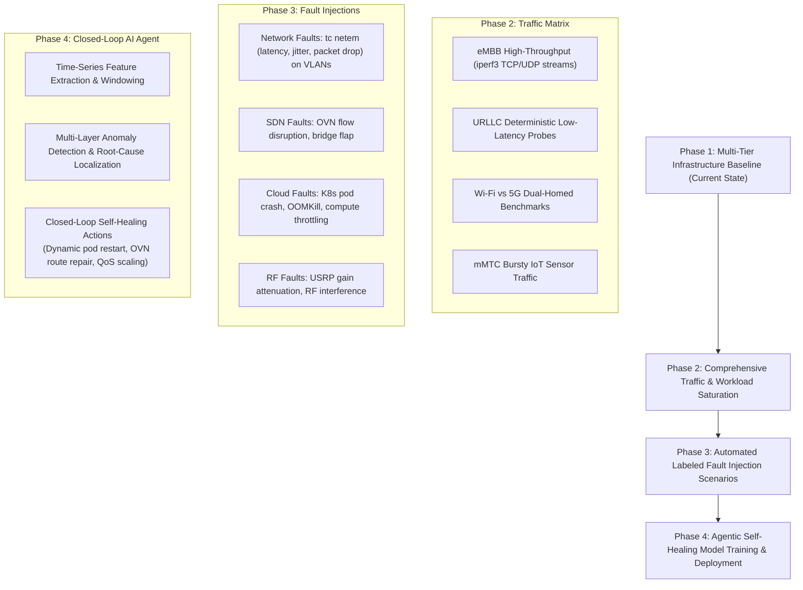

# Enterprise Cloud & Network Infrastructure Testbed: Architecture & Operational Manual

> **Mission & Architectural Scope:**  
> This testbed is an enterprise-grade **Cloud & Network Infrastructure Platform** designed to emulate modern hybrid data centers and telco edge environments. The platform integrates bare-metal orchestration (MAAS & Juju), software-defined virtualization (OpenStack Antelope & OVN), container orchestration (Kubernetes via OpenStack Magnum), physical networking (Managed Switches, 802.1Q VLANs, Firewalls, Enterprise Access Points), and edge multi-access workloads (5G Standalone Core & SDR RAN).  
>
> The primary objective is to generate comprehensive, multi-layer telemetry across the entire infrastructure stack (Hardware $\rightarrow$ Switch/VLAN Fabric $\rightarrow$ Hypervisor $\rightarrow$ K8s $\rightarrow$ Workloads) to train, deploy, and benchmark an **Agentic Self-Healing AI Pipeline**.

---

## 1. Unified Dashboard, Management & Access Directory

All services, fabric orchestrators, and infrastructure consoles are consolidated and reachable on the Dell PowerEdge primary interface (**`10.0.0.10`**):

| Layer / Subsystem | Dashboard / Portal URL | Username | Password / Credentials | Primary Infrastructure Role |
|---|---|---|---|---|
| **Data Center IPAM & DCIM** | [http://10.0.0.10:8001/](http://10.0.0.10:8001/) | `admin` | `admin123` | NetBox physical asset tracking, VLAN mapping, switch ports |
| **OpenStack Horizon** | [http://10.0.0.10/horizon/](http://10.0.0.10/horizon/) | `admin` *(Domain: `admin_domain`)* | `ahseiweeNgaik8uX` | Hypervisor management, tenant networks, router topology, VMs |
| **Juju Cloud Controller** | [http://10.0.0.10:8080/](http://10.0.0.10:8080/) | `admin` *(or `dashboard-admin`)* | `admin123` *(Open in Private Window)* | Model-driven bare-metal & OpenStack charm orchestration |
| **Canonical MAAS** | [http://10.0.0.10:5240/MAAS/](http://10.0.0.10:5240/MAAS/) | `admin` | `admin` *(or `123`)* | Bare-metal PXE provisioning, hardware discovery, IPAM |
| **Kubernetes Dashboard** | [http://10.0.0.10:8088/](http://10.0.0.10:8088/) | ServiceAccount | Token in `/home/hpe/k8s-5g/dashboard-token.txt` | Cluster containers, microservices, namespaces, pods |
| **Open5GS Core Portal** | [http://10.0.0.10:9999/](http://10.0.0.10:9999/) | `admin` | `1423` | Edge 5G Core subscriber database & slice provisioning |
| **RabbitMQ Management** | [http://10.0.0.10:15672/](http://10.0.0.10:15672/) | `guest` | `guest` | OpenStack control-plane message broker telemetry |
| **Dell Server Remote GUI**| `10.0.0.10:3389` | `hpe` | `123` | Dell PowerEdge RDP desktop environment |

---

## 2. Full-Stack End-to-End Infrastructure Topology

```mermaid
graph TD
    subgraph Physical Network & Switching Fabric
        SW["Enterprise Managed L2/L3 Switch"]
        FW["Firewall & NAT Gateway"]
        AP["Enterprise Wireless Access Points"]
        VLAN10["VLAN 10: Undercloud / Management (10.10.10.0/24)"]
        VLAN20["VLAN 20: Data / Provider / Wi-Fi Network"]
        SW --- VLAN10
        SW --- VLAN20
        SW --- FW
        VLAN20 --- AP
    end

    subgraph Dell PowerEdge R760xs [Head Node: 10.0.0.10 / 10.10.10.1]
        MAAS["Canonical MAAS (PXE / IPMI)"]
        JUJU["Juju Controller Engine"]
        NETBOX["NetBox DCIM & IPAM (Port 8001)"]
        
        subgraph OpenStack Antelope Cloud Infrastructure
            NOVA["Nova Compute / Libvirt"]
            OVN["Neutron OVN Distributed Virtual Routing"]
            GLANCE["Glance Image Service"]
            KEYSTONE["Keystone Identity Service"]
            HEAT["Heat Cloud Orchestration Engine"]
            MAGNUM["OpenStack Magnum (Container Cluster Service)"]
        end

        subgraph Kubernetes Cluster [Fedora CoreOS / k8s-5g-cluster]
            K8S_MASTER["Master Node: 192.168.100.72"]
            K8S_NODE0["Worker Node 0: 192.168.100.131"]
            K8S_NODE1["Worker Node 1: 192.168.100.174"]
            OPEN5GS["Edge Workload: Open5GS Core (13 Microservices)<br/>AMF NodePort 31412 | UPF NodePort 32152"]
        end

        TELEM["Multi-Tier Telemetry & Anomaly Engine<br/>(5g-telemetry.service)"]
    end

    subgraph Bare-Metal Compute Nodes
        subgraph Compute PC 1 [10.10.10.4]
            OVN_TUNNEL1["OVN Geneve Overlay Tunnel"]
            GNB_SVC["srsRAN CU/DU gNodeB Service"]
            USRP_TX["USRP B210 (34B18C8) Transmitter/Receiver"]
        end

        subgraph Compute PC 2 [10.10.10.5]
            OVN_TUNNEL2["OVN Geneve Overlay Tunnel"]
            WIFI_NIC["Wi-Fi 802.11 NIC (wlp2s0)"]
            UE_SVC1["UE Simulator 1 (USRP 34B1895)"]
            UE_SVC2["UE Simulator 2 (USRP 34B18A2)"]
            UE_SVC3["UE Simulator 3 (USRP 34B1905)"]
        end
    end

    VLAN10 --- Dell PowerEdge R760xs
    VLAN10 --- Compute PC 1
    VLAN10 --- Compute PC 2
    AP -.->|802.11 Wi-Fi Link| WIFI_NIC
    USRP_TX <===>|Over-the-Air RF / Band 3 FDD| UE_SVC1
    USRP_TX <===>|Over-the-Air RF / Band 3 FDD| UE_SVC2
```

---

## 3. Physical Hardware & Network Fabric Specifications

### A. Compute & Server Infrastructure
1. **Dell PowerEdge R760xs (Head Node / Controller & Primary Hypervisor):**
   - **Role:** Central Cloud Controller, SDN Controller, K8s Host, DCIM Host.
   - **Compute Capacity:** Dual Intel Xeon Scalable Processors (32 physical cores / 64 threads), 128+ GB Registered ECC DDR5 RAM.
   - **Storage Array:** Multi-TB SAS/NVMe enterprise storage (used for Glance image store, Cinder volumes, and persistent K8s volumes).
   - **Network Interfaces:** Primary external uplink (`10.0.0.10`), internal Undercloud interface on VLAN 10 (`10.10.10.1`), provider bridge interfaces for VLAN 20.
   - **Remote Access:** Passwordless SSH as `hpe`, RDP desktop on port `3389`.

2. **Bare-Metal Compute Node 1 (`compute-pc1` @ `10.10.10.4`):**
   - **Role:** Distributed OpenStack Compute node / Bare-Metal Edge Radio Server.
   - **NIC:** Gigabit Ethernet `enp1s0` attached to VLAN 10 switch port.
   - **SDN Integration:** Open vSwitch (OVS) with active Geneve tunnels to the Dell controller and `compute-pc2`.
   - **Attached SDR:** USRP B210 (`serial: 34B18C8`) over high-speed USB 3.0.
   - **Kernel Tuning:** Real-time scheduling privileges configured, CPU governor pinned to `performance` on all cores.

3. **Bare-Metal Compute Node 2 (`compute-pc2` @ `10.10.10.5`):**
   - **Role:** Distributed OpenStack Compute node / Multi-Access Client & Traffic Generator.
   - **NICs:**
     - Gigabit Ethernet `enp1s0` attached to VLAN 10 switch port (Geneve tunnels active).
     - Wireless Interface `wlp2s0` attached to local Wi-Fi.
   - **Attached SDRs:** 3x USRP B210 SDR units (`34B1895`, `34B18A2`, `34B1905`) over USB 3.0.
   - **Kernel Tuning:** CPU governor pinned to `performance` on all cores.

### B. Network Fabric, VLANs & Switching
* **VLAN 10 (Undercloud / Control / Management):**
  - **Subnet:** `10.10.10.0/24`
  - **Connected Hosts:** Dell Server (`10.10.10.1`), Compute 1 (`10.10.10.4`), Compute 2 (`10.10.10.5`), Juju Controller VM (`10.10.10.16`).
  - **Traffic Types:** SSH management, OpenStack API endpoints, OVN Geneve overlay encapsulation, SCTP N2 control-plane signaling.
* **VLAN 20 (Data / Provider / Access Point Network):**
  - **Subnet:** Isolated high-throughput provider network.
  - **Connected Infrastructure:** Physical Access Points configured with static IP addresses.
  - **DHCP Policy:** Zero DHCP on VLAN 20 by design. Clients connect using static IP configuration or AP-level gateway routing.
* **Open vSwitch (OVS) / OVN SDN Fabric:**
  - Automated virtual routers, distributed NAT, and security groups managed by Neutron.
  - Point-to-point Geneve overlay tunnels (`remote_ip="10.10.10.4"`, `remote_ip="10.10.10.5"`) handling cross-hypervisor traffic.

---

## 4. Cloud Orchestration & Virtualization Layer

### A. Canonical MAAS (Metal as a Service)
- **Portal:** `http://10.0.0.10:5240/MAAS/` (`admin` / `admin`)
- Discovers physical server inventory, handles DHCP/TFTP on private subnets, executes automated OS commissioning, and manages bare-metal node lifecycles.

### B. Canonical Juju Controller
- **Portal:** `http://10.0.0.10:8080/` (`admin` / `admin123`)
- Orchestrates multi-node OpenStack microservices via model-driven charms.

### C. OpenStack Antelope
- **Horizon Portal:** `http://10.0.0.10/horizon/` (`admin_domain` / `admin` / `ahseiweeNgaik8uX`)
- **Nova & Libvirt:** Enterprise hypervisor managing virtual machines and instances.
- **Neutron with OVN (Open Virtual Network):** Fully distributed SDN fabric with Geneve tunneling, security group enforcement, and distributed virtual routing (DVR).
- **Glance & Cinder:** Storage management backing local hypervisors and storage pools.
- **Heat Engine:** Infrastructure-as-Code orchestration for automated stack creation.

### D. OpenStack Magnum & Kubernetes Cluster
- **Cluster Identifier:** `c408fa77-0a0b-43ad-8c2d-7bf986adad40` (`k8s-5g-cluster`)
- **Operating System:** Fedora CoreOS 44 (`7.2.11-200.fc44.x86_64`)
- **Kubernetes Version:** `v1.23.3` (14+ hours continuous unbroken uptime)
- **Topology:**
  - `master-0` (`192.168.100.72`): API Server, Etcd, Controller Manager, Scheduler.
  - `node-0` (`192.168.100.131`): Worker node running container workloads.
  - `node-1` (`192.168.100.174`): Worker node exposing external NodePorts.
- **Kubeconfig File:** [`/home/hpe/k8s-5g/config`](file:///home/hpe/k8s-5g/config)

---

## 5. Workload Layer: 5G Core & Multi-Access Edge RAN

As a representative mission-critical telco cloud workload running across the OpenStack and Kubernetes infrastructure:

### A. Open5GS 5G Standalone Core (Namespace: `open5gs`)
13 cloud-native microservices running on the Kubernetes cluster:
* **Control Plane Functions:** AMF, SMF, NRF, SCP, AUSF, UDM, UDR, PCF, NSSF, BSF.
* **User Plane Function (UPF):** High-performance packet processing with TUN device routing.
* **Subscriber Database:** Stateful MongoDB with persistent storage (`mongodb-0`).
* **SCTP N2 Interface:** Exposed via NodePort `31412` on `192.168.100.174`.
* **GTP-U N3 Interface:** Exposed via NodePort `32152` on `192.168.100.174`.

### B. Radio Access Network (srsRAN Project 23.10.1 & srsUE)
* **gNodeB Base Station (`compute-pc1`):**
  - Service: `srsgnb.service`
  - Radio: USRP B210 (`34B18C8`) over USB 3.0
  - Radio Band: Band 3 FDD (1842.5 MHz DL / 1747.5 MHz UL), 10 MHz BW, 15 kHz SCS
  - PLMN: `99970` | TAC: `1`
  - Active over-the-air PRACH preambles detected at `rssi=-26.8 dB`.
* **User Equipment Simulators (`compute-pc2`):**
  - **UE 1:** `srsue1.service` | USRP B210 (`34B1895`) | IMSI `999700000000001` | Namespace `ue1`
  - **UE 2:** `srsue2.service` | USRP B210 (`34B18A2`) | IMSI `999700000000002` | Namespace `ue2`
  - **UE 3:** USRP B210 (`34B1905`) staged for additional traffic load

---

## 6. Autonomous Telemetry & Data Generation Engine

To power the self-healing AI pipeline, high-frequency multi-tier metrics are collected across hardware, networks, OpenStack, Kubernetes, and workloads every 5 seconds via `5g-telemetry.service`:

* **CSV Dataset:** [`/home/hpe/telemetry/dataset/5g_telco_metrics.csv`](file:///home/hpe/telemetry/dataset/5g_telco_metrics.csv)
* **JSONL Dataset:** [`/home/hpe/telemetry/dataset/5g_telco_metrics.jsonl`](file:///home/hpe/telemetry/dataset/5g_telco_metrics.jsonl)

### Multi-Tier Observation Vector:
1. **Compute & Host Layer:** Dell server CPU load, RAM utilization percentage, disk I/O.
2. **SDN & Network Layer:** OVN tunnel connectivity, interface traffic rates, dropped packets.
3. **Container & Cloud Layer:** K8s healthy pod count (13/13 nominal), container restart counters.
4. **Protocol & Control Plane Layer:** AMF SCTP association state, NG-Setup tracking.
5. **Physical RF & Access Layer:** PRACH RSSI, SNR, Timing Advance (TA), PUSCH SINR, CRC outcomes.
6. **Ground-Truth Labeling:** Explicit fault labels (`fault_label`) and severity ratings (`anomaly_severity`).

---

## 7. Master Strategic Roadmap: Self-Healing Agent Pipeline



### Next Immediate Milestones:
1. **Workload Traffic Saturation:** Trigger synthetic `iperf3` and UDP ping bursts concurrently over the 5G radio interface and the physical Wi-Fi interface (`wlp2s0`) on `compute-pc2`.
2. **Automated Fault Injection Harness:** Run automated experiments injecting labeled network anomalies (e.g. `tc qdisc add dev enp1s0 root netem delay 50ms 10ms loss 5%`), K8s container crashes, and RF gain attenuation while logging to the dataset.
3. **Self-Healing Agent Deployment:** Train the anomaly detection & root-cause analysis (RCA) pipeline on the generated dataset and deploy it as a closed-loop autonomous daemon across the OpenStack and Kubernetes control planes.
