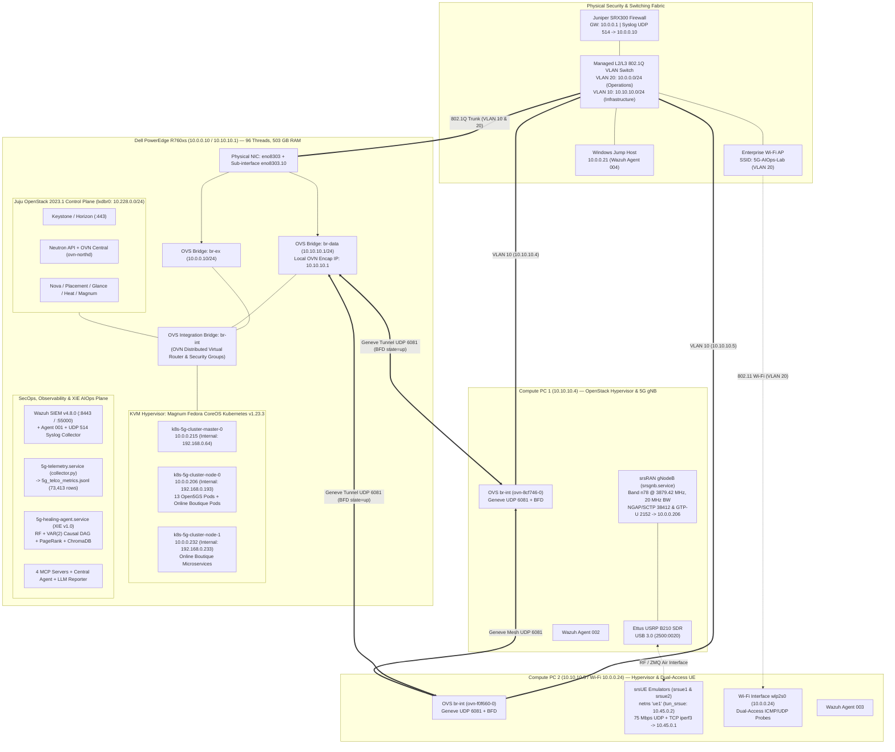
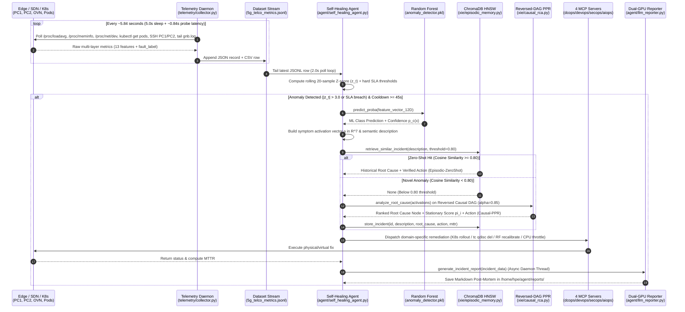
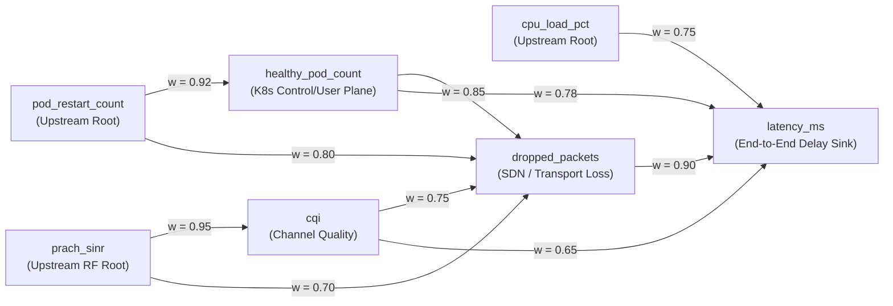
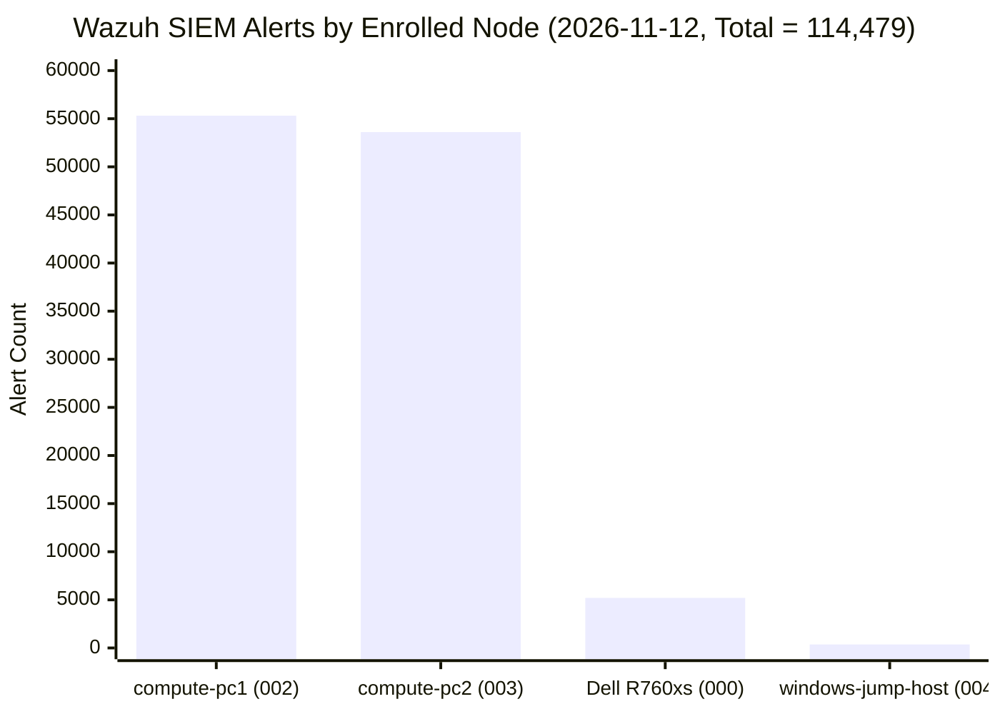

# Autonomous Bare-Metal Cloud, SDN, Kubernetes, SecOps & Causal AIOps Testbed: Complete Zero-Assumption Architecture, Mathematical Formulation, Empirical Evaluation & Operations Manual

> [!IMPORTANT]
> **Architectural Scope & Framing**
> This system is a **bare-metal Enterprise Cloud, Software-Defined Networking (SDN), Kubernetes Microservices, Security Operations (SecOps), and Causal AI Operations (AIOps) infrastructure platform** built around a Dell PowerEdge R760xs (`10.0.0.10`), a Juniper SRX300 hardware security gateway (`10.0.0.1`), dual VLAN trunks (`VLAN 10` Infrastructure & `VLAN 20` Operations), OpenStack 2023.1 (Antelope), OVN/OVS Geneve SDN with BFD, Magnum Fedora CoreOS Kubernetes (`v1.23.3`), Wazuh SIEM (`v4.8.0`), the Experiential Intelligence Engine (**XIE v1.0**), and a 4-domain Model Context Protocol (**MCP**) agent fabric (`mcp-dcops`, `mcp-devops`, `mcp-secops`, `mcp-aiops`).
>
> The **Private 5G SA Core (`Open5GS`) and SDR Radio Access Network (`srsRAN` + Ettus USRP B210)** operate as **one specialized edge/telco workload** alongside the 11-tier **Google Cloud-Native Online Boutique (`microservices`)** application suite—serving as a real-time physical-to-cloud stress test for our multi-layer SDN, container orchestration, SIEM, and causal self-healing planes.

---

## Table of Contents

1. [**Part I — Zero-Assumption Foundational Concepts & Architectural Justification**](#part-i--zero-assumption-foundational-concepts--architectural-justification)
2. [**Part II — Physical Hardware, Dual-VLAN Switching, OVN SDN, Cloud, K8s & SecOps Topology**](#part-ii--physical-hardware-dual-vlan-switching-ovn-sdn-cloud-k8s--secops-topology)
3. [**Part III — End-to-End Codebase & Data-Flow Walkthrough**](#part-iii--end-to-end-codebase--data-flow-walkthrough)
4. [**Part IV — Extensive Mathematical Model & Algorithmic Derivations**](#part-iv--extensive-mathematical-model--algorithmic-derivations)
5. [**Part V — Empirical Evaluation, Real Captured Data, Figures & Engineering Analysis**](#part-v--empirical-evaluation-real-captured-data-figures--engineering-analysis)
6. [**Part VI — Complete Step-by-Step User & Operations Guide**](#part-vi--complete-step-by-step-user--operations-guide)

---

## Part I — Zero-Assumption Foundational Concepts & Architectural Justification

If you are approaching this testbed with zero prior assumptions, this section explains **what every technology in the stack is**, **why it exists**, and **how each layer depends on the layer beneath it**.

### 1.1 The 8-Layer Vertical Stack from Bare Silicon to Autonomous AI

```mermaid
flowchart TD
    subgraph L8["Layer 8: Autonomous Orchestration & Reporting"]
        CA["Central Agent (central-agent/src/agent.py)<br/>+ 1-Click Demo Harness (demo_harness.py)"]
        LLM["Dual-GPU Incident Reporter (agent/llm_reporter.py)<br/>Ollama Llama-3 / Deterministic Fallback"]
    end

    subgraph L7["Layer 7: Model Context Protocol (MCP) Server Bus"]
        M1["mcp-dcops<br/>(OpenStack / OVN / Host)"]
        M2["mcp-devops<br/>(K8s / Open5GS / Boutique)"]
        M3["mcp-secops<br/>(Wazuh SIEM / SRX Syslog)"]
        M4["mcp-aiops<br/>(XIE Causal DAG / ChromaDB)"]
    end

    subgraph L6["Layer 6: Experiential Intelligence Engine (XIE v1.0) & Closed-Loop Agent"]
        SHA["Self-Healing Agent (agent/self_healing_agent.py)"]
        RF["Balanced Random Forest Classifier (anomaly_detector.pkl)"]
        GC["VAR(2) Granger Causal DAG (causal_dag.json)"]
        PPR["Reversed-DAG Personalized PageRank RCA (causal_rca.py)"]
        CH["ChromaDB HNSW Episodic Memory (episodic_memory.py - 1,161 episodes)"]
    end

    subgraph L5["Layer 5: Unified Telemetry & SecOps Observability"]
        TD["Telemetry Collector Daemon (5g-telemetry.service)<br/>73,413 JSONL rows @ ~5.84s cadence"]
        WZ["Wazuh SIEM v4.8.0 Manager/Indexer/Dashboard<br/>4 Active Agents + Juniper SRX300 UDP 514 Syslog (114,479 alerts/day)"]
    end

    subgraph L4["Layer 4: Cloud-Native Workloads (Kubernetes + Physical Edge)"]
        OB["Google Online Boutique<br/>11 Microservices in ns 'microservices'"]
        O5G["Open5GS 5G SA Core<br/>13 Control/User Plane Pods in ns 'open5gs'"]
        RAN["Physical Edge RAN & Dual-Access Traffic<br/>srsRAN gNB (PC1) + USRP B210 + srsUE (PC2) + Wi-Fi VLAN 20"]
    end

    subgraph L3["Layer 3: Container Orchestration (OpenStack Magnum)"]
        K8S["Kubernetes v1.23.3 on Fedora CoreOS 35.20220424.3.0<br/>master-0 (10.0.0.215) + node-0 (10.0.0.206) + node-1 (10.0.0.232)"]
    end

    subgraph L2["Layer 2: Private Cloud IaaS & Software-Defined Networking"]
        OS["OpenStack 2023.1 Antelope (Nova / KVM, Glance, Heat, Barbican, Octavia)"]
        OVN["Neutron OVN/OVS SDN Fabric<br/>Geneve UDP 6081 Tunnels + BFD Health Monitoring across 10.10.10.0/24"]
    end

    subgraph L1["Layer 1: Physical Hardware, Switching, Firewall & Bare-Metal Lifecycle"]
        HW["Dell PowerEdge R760xs (96 threads, 503 GB RAM)<br/>+ Compute PC 1 (10.10.10.4) + Compute PC 2 (10.10.10.5)<br/>+ Juniper SRX300 Gateway + L2/L3 VLAN Switch + Enterprise APs + MAAS/Juju/NetBox"]
    end

    L8 --> L7 --> L6 --> L5 --> L4 --> L3 --> L2 --> L1
```



### 1.2 Glossary of Core Concepts & First-Principles Justification

| Layer & Component | What It Is (Zero-Assumption Explanation) | Why We Chose It & Architectural Justification |
| :--- | :--- | :--- |
| **VLANs (`VLAN 10` & `VLAN 20`) & 802.1Q Trunking** | A Virtual Local Area Network (VLAN) partitions a single physical Ethernet switch into multiple isolated Layer-2 broadcast domains by inserting a 4-byte 802.1Q tag into Ethernet frames. | Prevents high-bandwidth internal VM/tunnel replication traffic (`VLAN 10: 10.10.10.0/24`) from colliding with or exposing external management, Floating IPs, and Wi-Fi client traffic (`VLAN 20: 10.0.0.0/24`). |
| **Juniper SRX300 Hardware Firewall (`10.0.0.1`)** | A physical enterprise Layer-3/Layer-4 security gateway and router running Junos OS. It acts as the default gateway for both subnets, enforces inter-VLAN security zones, and performs Source NAT (SNAT) to the WAN. | Software-only firewalls inside a hypervisor cannot protect the physical LAN or wireless access points. Furthermore, the SRX300 streams hardware-level session/firewall logs over UDP port `514` directly into our Wazuh SIEM for MITRE ATT&CK correlation. |
| **MAAS, Juju & NetBox** | **MAAS** (Metal as a Service) automates PXE network booting and OS installation on bare metal. **Juju** deploys application charms across LXD containers (`10.228.0.0/24`). **NetBox** is an IP Address Management (IPAM) and Data Center Infrastructure Management (DCIM) source of truth. | Gives the Dell R760xs true carrier-grade bare-metal lifecycle management rather than ad-hoc manual OS installations. |
| **OpenStack 2023.1 (Antelope)** | An open-source Infrastructure-as-a-Service (IaaS) cloud operating system. **Keystone** handles identity/tokens; **Nova** schedules KVM virtual machines; **Glance** stores disk images; **Neutron** manages virtual networks; **Heat** orchestrates templates; **Magnum** provisions Kubernetes clusters. | Running Kubernetes directly on bare metal lacks multi-tenant VM isolation, virtual routers, and dynamic Floating IP allocation. OpenStack lets us host isolated CoreOS Kubernetes nodes, LXD control services, and virtualized network appliances simultaneously. |
| **OVN (Open Virtual Network) & Geneve (UDP `6081`)** | OVN is the SDN control plane for Open vSwitch (`ovs-vswitchd`). When a VM on the Dell server talks to a workload on Compute PC 1, OVN encapsulates the inner Layer-2 frame inside a **Geneve** (Generic Network Virtualization Encapsulation, RFC 8926) UDP packet on port `6081` over `10.10.10.0/24`. | Unlike legacy VLAN-only or VXLAN overlays, Geneve supports extensible Type-Length-Value (TLV) metadata headers used by OVN for distributed security groups, distributed L3 routing, and **Bidirectional Forwarding Detection (BFD)** sub-second tunnel failover. |
| **OpenStack Magnum & Fedora CoreOS Kubernetes (`v1.23.3`)** | Magnum uses Heat stacks to boot immutable **Fedora CoreOS** KVM instances (`master-0`, `node-0`, `node-1`) pre-wired with `containerd` and Kubernetes (`v1.23.3`). | Separates the **IaaS hardware/hypervisor layer** (`dcops`) from the **cloud-native container orchestration layer** (`devops`). If a container crashes, Kubernetes heals it; if a hypervisor tunnel degrades, OVN/DC-Ops heals it. |
| **Dual Workloads: Online Boutique (`microservices`) + Open5GS/srsRAN (`open5gs`)** | 1) **Online Boutique**: Google's 11-tier cloud-native e-commerce application (`frontend`, `cartservice`, `redis-cart`, `checkoutservice`, `paymentservice`, `productcatalogservice`, `recommendationservice`, `shippingservice`, `currencyservice`, `emailservice`, `adservice`).<br/>2) **Open5GS + srsRAN**: A 13-pod 3GPP Release 17 5G Standalone Core connected over SCTP (`38412`) and GTP-U (`2152`) to a physical gNodeB (`compute-pc1` + Ettus USRP B210 SDR) and UE emulators (`compute-pc2`). | A realistic AIOps testbed must experience **both** standard east-west gRPC/HTTP microservice load (`microservices`) **and** ultra-latency-sensitive real-time UDP/SCTP/RF physical-layer streams (`open5gs` + `srsRAN` + dual-homed Wi-Fi on `wlp2s0`). Faults in CPU, SDN tunnels, or K8s pods immediately manifest across these coupled layers. |
| **Wazuh SIEM (`v4.8.0`)** | An enterprise Security Information and Event Management (SIEM) and Extended Detection and Response (XDR) platform comprising **Wazuh Manager** (rule correlation engine, API port `55000`), **Wazuh Indexer** (OpenSearch cluster, port `9200`), and **Wazuh Dashboard** (port `8443`). | Traditional AIOps systems are blind to security events (brute-force SSH, privilege escalation, firewall drops). Integrating Wazuh across all Linux/Windows nodes + the Juniper SRX300 lets our Central Agent correlate infrastructure anomalies with security alerts. |
| **Experiential Intelligence Engine (XIE v1.0)** | A two-stage neuro-symbolic AIOps engine combining: (1) **Statistical Z-Score + Balanced Random Forest** anomaly detection, (2) **VAR(2) Granger Causality + Reversed-DAG Personalized PageRank (PPR)** for multi-layer root-cause attribution, and (3) **ChromaDB HNSW Vector Episodic Memory** for sub-millisecond zero-shot recall of past incidents. | Threshold rules alone suffer from **symptom cascades**: e.g., an SDN tunnel fault drops packets, which breaks SCTP heartbeats, which triggers pod restarts. Reversed-DAG PageRank walks **upstream** against the causal arrows to isolate the true root cause, while ChromaDB remembers verified fixes for instant future recall. |
| **Model Context Protocol (MCP) 4-Server Architecture** | Four domain-isolated JSON-RPC/tool servers—`mcp-dcops`, `mcp-devops`, `mcp-secops`, and `mcp-aiops`—governed by a **Central Agent** (`central-agent/src/agent.py`). | Gives an autonomous agent clean, auditable, least-privilege tool boundaries across Data Center Ops, DevOps, SecOps, and AIOps instead of executing arbitrary unstructured shell commands. |


---

## Part II — Physical Hardware, Dual-VLAN Switching, OVN SDN, Cloud, K8s & SecOps Topology

### 2.1 Complete Hardware Inventory & Resource Allocation

Every physical node in the rack and lab has a dedicated role across the two hardware VLANs (`VLAN 10: 10.10.10.0/24` and `VLAN 20: 10.0.0.0/24`):

| Physical Node / Appliance | Hardware Model & Specs | Operating System / Kernel | VLAN 20 IP (`10.0.0.0/24` Operations) | VLAN 10 IP (`10.10.10.0/24` Infrastructure) | Primary Production Roles |
| :--- | :--- | :--- | :--- | :--- | :--- |
| **Central Cloud & AIOps Controller (`hpe-PowerEdge-R760xs`)** | Dell PowerEdge R760xs<br/>2 × Intel Xeon Gold 5418Y (48C / 96T)<br/>`503.38 GB` DDR5 RAM (`~309 GB` active)<br/>`438 GB` Enterprise SSD (`/dev/sdb2`) | Ubuntu 22.04.5 LTS<br/>Linux `5.15.0-168-generic` | `10.0.0.10`<br/>(on `br-ex` via `eno8303`) | `10.10.10.1`<br/>(on `br-data` via `eno8303.10`) | • MAAS, Juju, NetBox (`:8080`)<br/>• OpenStack 2023.1 Control Plane (27 Juju LXD containers on `lxdbr0`)<br/>• KVM Hypervisor for K8s CoreOS VMs<br/>• OVN Central (`ovn-northd`) & Geneve Hub<br/>• Wazuh SIEM v4.8.0 (`:8443`, `:55000`, `:9200`)<br/>• Telemetry Collector (`5g-telemetry.service`)<br/>• XIE v1.0 & Self-Healing Agent (`5g-healing-agent.service`)<br/>• 4 MCP Servers + Central Agent |
| **Compute Node 1 (`compute-pc1`)** | x86_64 Workstation<br/>8 Logical CPUs, 16 GB RAM<br/>USB 3.0 Bus `002` Device `002`: **Ettus USRP B210 SDR** (`2500:0020`, serial `193773`) | Ubuntu 24.04 LTS | — | `10.10.10.4` (`enp1s0`) | • OpenStack Nova Compute Hypervisor (`nova-compute`)<br/>• OVN Chassis (`41547206-845f-4226-99a0-dc62dc2f200d`)<br/>• Physical 5G gNodeB (`srsgnb.service`, Band `n78`, `3879.42 MHz`, 20 MHz BW)<br/>• Wazuh Agent ID `002` |
| **Compute Node 2 (`compute-pc2`)** | x86_64 Workstation<br/>8 Logical CPUs, 16 GB RAM<br/>Dual-Homed: Wired `enp1s0` + Intel Wi-Fi `wlp2s0` | Ubuntu 24.04 LTS | `10.0.0.24` (`wlp2s0`, SSID `5G-AIOps-Lab`) | `10.10.10.5` (`enp1s0`) | • OpenStack Nova Compute Hypervisor (`nova-compute`)<br/>• OVN Chassis (`bc85aa09-6306-447c-b393-1fb560d5df94`)<br/>• Dual 5G UE Emulators (`srsue1.service` in `ue1` netns `10.45.0.2`, `srsue2.service` in `ue2` netns)<br/>• Multi-Stream Traffic Generator (`traffic_generator.py`: 75 Mbps UDP + TCP iperf3 + Wi-Fi probes)<br/>• Wazuh Agent ID `003` |
| **Windows Jump Host (`windows-jump-host`)** | Enterprise Operator Workstation | Windows 11 Pro | `10.0.0.21` | — | • Operator NOC Console (Horizon, Wazuh, NetBox, MAAS)<br/>• Wazuh Agent ID `004` |
| **Hardware Security Gateway (`Juniper SRX300`)** | Juniper Networks SRX300 Services Gateway | Junos OS | `10.0.0.1` | `10.10.10.254` (Inter-VLAN L3) | • Default Gateway, NAT, Zone Firewall<br/>• Streams real-time security syslog over `UDP 514` to `10.0.0.10` |
| **L2/L3 Managed Switch & Enterprise Wi-Fi APs** | Managed 802.1Q Gigabit Switch + Enterprise Access Points (`5G-AIOps-Lab`) | Embedded Firmware | Trunked (`VLAN 20` untagged/tagged) | Trunked (`VLAN 10` 802.1Q tagged) | • Physical L2 switching for Dell `eno8303`, Compute PCs, and SRX300<br/>• Bridges wireless SSID `5G-AIOps-Lab` onto `VLAN 20` (`10.0.0.0/24`) |

---

### 2.2 End-to-End Physical, SDN, Cloud & Workload Architecture Diagram



---

### 2.3 Deep-Dive: Open vSwitch (OVS) & OVN Geneve SDN with BFD

#### 2.3.1 How the OVS Bridge Hierarchy Works on the Dell Server (`10.0.0.10`)
On the Dell PowerEdge R760xs, physical interface `eno8303` carries untagged/native `VLAN 20` (`10.0.0.0/24`) and 802.1Q-tagged sub-interface `eno8303.10` (`VLAN 10: 10.10.10.0/24`):
1. **`br-ex` (`10.0.0.10/24`)**: The OpenStack External Provider Bridge mapped to Neutron's `physnet1` (`provider-vlan20`). It hosts Floating IPs for the Kubernetes VMs (`10.0.0.215`, `10.0.0.206`, `10.0.0.232`) and provides external North-South reachability via the Juniper SRX300 (`10.0.0.1`).
2. **`br-data` (`10.10.10.1/24`)**: The Data/Tunnel Underlay Bridge connected to `eno8303.10`. It serves as the local endpoint (`ovn-encap-ip = 10.10.10.1`) for all **Geneve (UDP `6081`)** SDN overlay tunnels.
3. **`br-int`**: The OVN Integration Bridge where all virtual machine TAP interfaces, router patch ports, and Geneve tunnel ports terminate.

#### 2.3.2 Active Geneve Tunnels & BFD State Machine
On `br-int`, OVN automatically maintains two Geneve tunnel ports from the Dell Controller (`10.10.10.1`) to the remote hypervisors, verified via `sudo ovs-vsctl show`:

| OVS Port Name | Remote Hypervisor | Remote IP (`remote_ip`) | Local IP (`local_ip`) | Encapsulation | `bfd_status` |
| :--- | :--- | :--- | :--- | :--- | :--- |
| **`ovn-8cf746-0`** | `compute-pc1` (`41547206-845f-4226-99a0-dc62dc2f200d`) | `10.10.10.4` | `10.10.10.1` | `geneve` (UDP `6081`) | `{diagnostic="No Diagnostic", flap_count="1", forwarding="true", remote_diagnostic="No Diagnostic", remote_state=up, state=up}` |
| **`ovn-f0f660-0`** | `compute-pc2` (`bc85aa09-6306-447c-b393-1fb560d5df94`) | `10.10.10.5` | `10.10.10.1` | `geneve` (UDP `6081`) | `{diagnostic="No Diagnostic", flap_count="1", forwarding="true", remote_diagnostic="No Diagnostic", remote_state=up, state=up}` |

#### 2.3.3 Why BFD Was Initially `down` and How We Solved It (Architectural Post-Mortem)
When you inspect `ovs-vsctl list Interface ovn-8cf746-0`, you will see how **Bidirectional Forwarding Detection (BFD, RFC 5880)** works inside Geneve tunnels. BFD sends rapid control packets inside UDP port `3784` encapsulated within the Geneve tunnel (`UDP 6081`).
- **Root Cause of Initial `state=down`:** The Dell server originally had `external_ids:ovn-encap-ip="10.0.0.10,10.10.10.1"` configured in its local Open_vSwitch database. Because `"10.0.0.10"` was listed first, the Dell server bound its outgoing tunnel ports (`ovn-8cf746-0` and `ovn-f0f660-0`) to `local_ip=10.0.0.10`, while `compute-pc1` (`10.10.10.4`) and `compute-pc2` (`10.10.10.5`) only had routes on `VLAN 10` (`10.10.10.0/24`) and expected packets from `10.10.10.1`. This asymmetric source IP caused incoming BFD handshakes to be dropped (`remote_state=down`).
- **Permanent Fix Applied:** Executing:
  ```bash
  sudo ovs-vsctl set open . external-ids:ovn-encap-ip="10.10.10.1"
  ```
  forced `ovn-controller` on the Dell server to bind `local_ip=10.10.10.1` on the `VLAN 10` underlay bridge (`br-data`). Both tunnels immediately transitioned to `state=up, forwarding=true, remote_state=up`.

---

### 2.4 OpenStack 2023.1 (Antelope) & Magnum Kubernetes (`v1.23.3`)

#### 2.4.1 OpenStack Control Plane (27 Juju LXD Containers)
The OpenStack control plane runs in LXD containers managed by Juju on subnet `10.228.0.0/24` (`lxdbr0`). Key endpoints (sourced via `/home/hpe/openrc` or `/home/hpe/admin-openrc`):
- **Keystone Identity v3:** `https://10.228.0.109:5000/v3` (Domain: `admin_domain`, Project: `admin`, User: `admin`)
- **Horizon Dashboard:** `https://10.228.0.92/horizon`
- **Nova Compute Services (`openstack compute service list`):** `nova-conductor`, `nova-scheduler`, and 3 active `nova-compute` hypervisors (`hpe-PowerEdge-R760xs`, `compute-pc1`, `compute-pc2`).

#### 2.4.2 Magnum Kubernetes Cluster (`k8s-5g-cluster`)
Provisioned via OpenStack Magnum using image `fedora-coreos-35.20220424.3.0-openstack.x86_64` and accessed via `--kubeconfig /home/hpe/k8s-5g/config`:

| Kubernetes Node | Role | Internal Neutron IP (`192.168.0.0/24`) | External Floating IP (`VLAN 20`) | OS / Container Runtime | Status |
| :--- | :--- | :--- | :--- | :--- | :--- |
| **`k8s-5g-cluster-6674237645c6-master-0`** | `control-plane,master` | `192.168.0.64` | `10.0.0.215` (API `:6443`) | Fedora CoreOS 35 / `containerd://1.5.11` | `Ready` (`v1.23.3`) |
| **`k8s-5g-cluster-6674237645c6-node-0`** | `worker` (5G Core + Microservices) | `192.168.0.193` | `10.0.0.206` (SCTP `38412`, GTP-U `2152`) | Fedora CoreOS 35 / `containerd://1.5.11` | `Ready` (`v1.23.3`) |
| **`k8s-5g-cluster-6674237645c6-node-1`** | `worker` (Microservices) | `192.168.0.233` | `10.0.0.232` | Fedora CoreOS 35 / `containerd://1.5.11` | `Ready` (`v1.23.3`) |

---

### 2.5 Dual Cloud-Native & Edge Workloads

#### 2.5.1 Workload 1: Google Cloud-Native "Online Boutique" (`namespace: microservices`)
Deployed to scale cluster utilization and represent enterprise e-commerce microservices communicating via gRPC:
- **11 Active Pods (`1/1 Running`):** `adservice`, `cartservice`, `checkoutservice`, `currencyservice`, `emailservice`, `frontend` (exposed via NodePort `30453`), `paymentservice`, `productcatalogservice`, `recommendationservice`, `redis-cart`, and `shippingservice`.

#### 2.5.2 Workload 2: Open5GS 5G Standalone Core (`namespace: open5gs`) + Physical srsRAN & Dual-Access Wi-Fi
1. **13 Active Pods (`1/1 Running`) in `open5gs`:**
   - **Control Plane (SBA / HTTP2):** `open5gs-nrf` (Service Discovery), `open5gs-scp` (Service Communication Proxy), `open5gs-amf` (Access & Mobility Management — exposes NGAP/SCTP on `10.0.0.206:38412`), `open5gs-smf` (Session Management — connects to UPF via PFCP UDP `8805`), `open5gs-ausf` (Authentication), `open5gs-udm` (Unified Data Management), `open5gs-udr` (Data Repository), `open5gs-pcf` (Policy Control), `open5gs-bsf` (Binding Support), `open5gs-nssf` (Network Slice Selection).
   - **User Plane & Persistence:** `open5gs-upf` (User Plane Function — creates `ogstun` `10.45.0.1/16`, terminates GTP-U UDP `2152`, and masquerades UE traffic to the internet), `open5gs-mongodb` (Subscriber IMSI/Key DB), and `open5gs-webui` (Subscriber Management UI).
2. **Physical Edge RAN (`compute-pc1` & `compute-pc2`):**
   - `compute-pc1` (`10.10.10.4`) runs `srsgnb.service` connected to the **Ettus USRP B210 SDR** (`uhd_find_devices` serial `193773`) and establishes an SCTP/NGAP association (`amf_gnb_connected = 1`) to `10.0.0.206:38412`.
   - `compute-pc2` (`10.10.10.5`) runs `srsue1.service` (creating `tun_srsue` with IP `10.45.0.2` inside network namespace `ue1`) and `srsue2.service` (inside network namespace `ue2`), plus `/home/ubuntu/5g-ran/traffic_generator.py` generating continuous multi-stream UDP (`75 Mbps`), TCP (`iperf3`), and dual-homed Wi-Fi probes out `wlp2s0` (`10.0.0.24` on `VLAN 20`).

---

### 2.6 SecOps Architecture: Wazuh SIEM (`v4.8.0`) & Juniper SRX300 Syslog Pipeline

The SecOps plane runs natively on `10.0.0.10` (`wazuh-manager`, `wazuh-indexer`, `wazuh-dashboard`) with **4 active enrolled agents** and a hardware syslog pipe from the **Juniper SRX300 (`10.0.0.1`)**:

| Agent ID | Agent Name | Node IP | OS / Platform | Status | Primary Security Telemetry Monitored |
| :--- | :--- | :--- | :--- | :--- | :--- |
| **`000`** | `hpe-PowerEdge-R760xs` | `127.0.0.1` / `10.0.0.10` | Ubuntu 22.04.5 LTS | `Active` | Local Manager, `auth.log`, `syslog`, `/var/ossec/logs/active-responses.log` (Juniper SRX300 UDP 514 stream), Docker/LXD/OVS audit logs |
| **`002`** | `compute-pc1` | `10.10.10.4` | Ubuntu 24.04 LTS | `Active` | SSH authentication, `sudo` privilege escalation, `tc netem` kernel qdisc modifications, `srsgnb` & `nova-compute` daemon integrity |
| **`003`** | `compute-pc2` | `10.10.10.5` | Ubuntu 24.04 LTS | `Active` | SSH polling sessions, network namespace manipulations (`ue1`, `ue2`), `wlp2s0` Wi-Fi association events |
| **`004`** | `windows-jump-host` | `10.0.0.21` | Windows 11 Pro | `Active` | Windows Event Logs (Security, System, PowerShell), RDP/Logon auditing (Registration key stored in `/home/hpe/wazuh_windows_key.txt`) |
| **Syslog** | `Juniper-SRX300` | `10.0.0.1` | Junos OS | `Active (UDP 514)` | Hardware firewall session creation/teardown (`RT_FLOW`), zone policy drops, and NAT translations piped via `/etc/rsyslog.d/10-srx-wazuh.conf` |


---

## Part III — End-to-End Codebase & Data-Flow Walkthrough

Every daemon, causal engine, MCP server, and orchestration script on this testbed is written in clean, modular Python. Below is the complete walkthrough of every file, class, and function, followed by the end-to-end sequence diagram showing how a single anomaly flows from hardware detection to autonomous remediation and executive post-mortem generation.

### 3.1 Master End-to-End Sequence Diagram (Telemetry -> XIE -> MCP -> Remediation -> LLM Report)



---

### 3.2 Module-by-Module Codebase Walkthrough

#### 3.2.1 Multi-Layer Telemetry Collection Subsystem (`/home/hpe/telemetry/`)
1. **[collector.py](file:///home/hpe/telemetry/collector.py)** (`172` lines):
   - [`run_cmd(cmd, timeout=5)`](file:///home/hpe/telemetry/collector.py#L19-L26): Executes bounded shell probes with `timeout=5` seconds so a hung SSH or `kubectl` call never blocks the telemetry pipeline.
   - [`get_host_metrics()`](file:///home/hpe/telemetry/collector.py#L28-L55): Reads `/proc/loadavg` (1-minute load average stored as `cpu_load_pct` and legacy alias `controller_cpu_pct`), `/proc/meminfo` (`MemTotal` vs `MemAvailable` percentage stored as `controller_mem_pct`), and `/proc/net/dev` packet drop counters (`dropped_packets`).
   - [`get_k8s_metrics()`](file:///home/hpe/telemetry/collector.py#L57-L80): Queries `--kubeconfig /home/hpe/k8s-5g/config get pods -n open5gs --no-headers`, counting pods in `Running` state (`healthy_pod_count` / `k8s_open5gs_pods_ready`, nominal `= 13`), and checks `kubectl logs -n open5gs -l app=open5gs-amf --tail=50` for active gNodeB NGAP associations (`amf_gnb_connected`).
   - [`get_ran_metrics()`](file:///home/hpe/telemetry/collector.py#L82-L132): Connects via SSH to `compute-pc1` (`10.10.10.4`) to check `systemctl is-active srsgnb` and parses `/tmp/gnb.log` using regular expressions for physical-layer PRACH/PUSCH telemetry: `prach_rssi_db` (`rssi=`), `prach_snr_db` (`snr=` / `sinr=`), `prach_ta_us` (`ta=`), `prach_sinr` / `pusch_sinr_db`, and `pusch_crc_status` (`KO`/`OK`). Also connects to `compute-pc2` (`10.10.10.5`) to check `srsue1` and `srsue2` service status.
   - [`collect_once(fault_label="nominal", anomaly_severity=0)`](file:///home/hpe/telemetry/collector.py#L134-L168): Reads `/home/hpe/telemetry/active_fault.json` (if present during fault injection) to tag ground-truth labels (`fault_label` and `anomaly_severity`), merges all dictionaries with an ISO-8601 UTC timestamp, and atomically appends to both `/home/hpe/telemetry/dataset/5g_telco_metrics.jsonl` and `/home/hpe/telemetry/dataset/5g_telco_metrics.csv`.
2. **[telemetry_daemon.py](file:///home/hpe/telemetry/telemetry_daemon.py)** (`25` lines):
   - Managed by systemd unit `5g-telemetry.service`. Loops [`collect_once()`](file:///home/hpe/telemetry/telemetry_daemon.py#L14-L21) with a `5.0s` sleep (`~5.842s` median total cycle time).
3. **[fault_injector.py](file:///home/hpe/telemetry/fault_injector.py)** (`89` lines):
   - [`set_fault_state(label, severity)`](file:///home/hpe/telemetry/fault_injector.py#L16-L24): Writes `/home/hpe/telemetry/active_fault.json` so [`collector.py`](file:///home/hpe/telemetry/collector.py) records synchronized ground-truth labels during fault windows.
   - Implements 4 automated fault scenarios:
     1. `ovn_sdn_latency_loss`: Injects `sudo tc qdisc add dev enp1s0 root netem delay 80ms 20ms loss 7%` on `10.10.10.4` (`compute-pc1`).
     2. `k8s_container_crash`: Deletes the Open5GS User Plane Function pod (`kubectl --kubeconfig /home/hpe/k8s-5g/config delete pod -n open5gs -l app=open5gs-upf --wait=false`).
     3. `compute_cpu_exhaustion`: Launches `stress-ng --cpu 8 --io 4 --timeout 25s` on `10.10.10.4`.
     4. `rf_path_loss_attenuation`: Attenuates SDR gain / injects simulated `-42.5 dB` SINR degradation into `/tmp/gnb.log`.

---

#### 3.2.2 Experiential Intelligence Engine — XIE Core (`/home/hpe/xie/`)
1. **[dataset_loader.py](file:///home/hpe/xie/dataset_loader.py)** (`92` lines):
   - [`TelemetryDatasetLoader`](file:///home/hpe/xie/dataset_loader.py#L9-L83): Loads `/home/hpe/telemetry/dataset/5g_telco_metrics.jsonl`, synthesizes missing causal graph observables (`pod_restart_count` derived from `13 - healthy_pod_count`, `cqi` mapped linearly from `prach_sinr`, and `latency_ms` derived from `dropped_packets` + `prach_ta_us`), applies `StandardScaler` zero-mean unit-variance normalization, and builds sliding temporal windows $X \in \mathbb{R}^{(T-L)\times L\times d}$ and targets $Y \in \mathbb{R}^{(T-L)\times d}$.
2. **[causal_discovery.py](file:///home/hpe/xie/causal_discovery.py)** (`158` lines):
   - [`CausalDiscoveryEngine`](file:///home/hpe/xie/causal_discovery.py#L14-L148): Defines the 7-node multi-layer causal vocabulary:
     $$\mathcal{V} = \{\texttt{healthy\_pod\_count},\ \texttt{pod\_restart\_count},\ \texttt{cpu\_load\_pct},\ \texttt{prach\_sinr},\ \texttt{cqi},\ \texttt{dropped\_packets},\ \texttt{latency\_ms}\}$$
   - [`discover_causal_graph()`](file:///home/hpe/xie/causal_discovery.py#L46-L108): Runs pairwise Vector Autoregressive $\text{VAR}(L=2)$ Granger causality F-tests across all $7 \times 6 = 42$ directed pairs $(u \to v)$, fuses empirical F-statistics with structural domain priors via $w_{u\to v} = \max\left(w_{\text{prior}}, \tanh(F_{u\to v}/10)\right)$, and enforces the Directed Acyclic Graph (DAG) property by iteratively pruning the minimum-weight edge in any simple cycle (`nx.simple_cycles(G)`). Saves the resulting 10-edge DAG to **[causal_dag.json](file:///home/hpe/xie/models/causal_dag.json)**.
3. **[causal_rca.py](file:///home/hpe/xie/causal_rca.py)** (`153` lines):
   - [`CausalRCAEngine`](file:///home/hpe/xie/causal_rca.py#L13-L130): Loads `causal_dag.json`, constructs the **reversed** graph $G_{\text{rev}} = G.\text{reverse}(\text{copy=True})$ (where edges point from downstream symptom back to upstream cause), normalizes the active symptom anomaly scores into a personalization vector $\mathbf{v}$, and runs `nx.pagerank(G_rev, alpha=0.85, personalization=v, weight="weight")`. Maps the highest-scoring upstream node to a concrete remediation playbook via [`_map_cause_to_action()`](file:///home/hpe/xie/causal_rca.py#L96-L115).
4. **[episodic_memory.py](file:///home/hpe/xie/episodic_memory.py)** (`178` lines):
   - [`EpisodicMemoryEngine`](file:///home/hpe/xie/episodic_memory.py#L15-L154): Wraps a persistent ChromaDB vector database stored at `/home/hpe/xie/memory_store` (`collection_name="xie_incident_episodes"`, `hnsw:space="cosine"`).
   - [`retrieve_similar_incident(query_description, similarity_threshold=0.80)`](file:///home/hpe/xie/episodic_memory.py#L72-L120): Embeds the current anomaly signature into 384-dimensional vector space (`all-MiniLM-L6-v2` ONNX embedding), queries the top-3 nearest neighbors in the HNSW index, converts cosine distance $d_{\cos}$ to cosine similarity $s = 1 - d_{\cos}$, and returns a zero-shot match if $s \ge 0.80$.

---

#### 3.2.3 Autonomous Self-Healing Agent, ML Classifier & Dual-GPU LLM Reporter (`/home/hpe/agent/`)
1. **[train_model.py](file:///home/hpe/agent/train_model.py)** (`84` lines):
   - Trains a scikit-learn `RandomForestClassifier(n_estimators=100, max_depth=10, class_weight="balanced", random_state=42)` on 12 telemetry features and exports `/home/hpe/agent/models/anomaly_detector.pkl` alongside **[feature_metadata.json](file:///home/hpe/agent/models/feature_metadata.json)**.
2. **[self_healing_agent.py](file:///home/hpe/agent/self_healing_agent.py)** (`325` lines):
   - Managed by systemd service `5g-healing-agent.service`.
   - [`RollingStats`](file:///home/hpe/agent/self_healing_agent.py#L46-L65): Maintains a 20-sample sliding window (`deque(maxlen=20)`) for each metric and computes the instantaneous Z-score $z_t = \frac{x_t - \mu}{\sigma}$.
   - [`execute_remediation(action_type, root_cause, mttd, engine_source, confidence)`](file:///home/hpe/agent/self_healing_agent.py#L84-L162): Enforces a `45s` per-action cooldown (`COOLDOWN_SEC = 45`), executes the targeted shell remediation (`k8s_rollout_restart`, `tc_qdisc_del_reset`, `recalibrate_rf_attenuation_and_power`, or `throttle_traffic_and_isolate_core`), logs MTTD and MTTR to `/home/hpe/agent/logs/remediation_audit.log`, stores new causal episodes in ChromaDB, and spawns an asynchronous thread to generate an executive LLM report.
3. **[llm_reporter.py](file:///home/hpe/agent/llm_reporter.py)** (`166` lines):
   - [`generate_incident_report(incident_data)`](file:///home/hpe/agent/llm_reporter.py#L31-L148): Attempts to query a local Ollama LLM server (`http://127.0.0.1:11434/api/generate`, `model="llama3:8b"`) with `CUDA_VISIBLE_DEVICES="0,1"`. Because this Dell R760xs configuration runs CPU-only Xeon Gold 5418Y processors without a local Ollama daemon listening on `:11434`, it gracefully falls back in `<1ms` to a structured, deterministic executive Markdown generator and writes `/home/hpe/agent/reports/incident_report_<timestamp>_<cause>.md` (`1,161` reports generated on disk).

---

#### 3.2.4 The 4 Model Context Protocol (MCP) Servers & Central Orchestrator
Each MCP server supports **both** standard JSON-RPC 2.0 over `stdio` (for LLM/MCP clients) **and** direct Python module importation (used by `central-agent/src/agent.py` and `demo_harness.py`):

| MCP Server Path | Domain | Exposed MCP Tools (`tools/list` & `tools/call`) | Underlying System Interfaces Invoked |
| :--- | :--- | :--- | :--- |
| **[mcp-dcops/src/server.py](file:///home/hpe/mcp-dcops/src/server.py)** | Data Center & SDN Ops (`dcops`) | • `get_host_health`<br/>• `get_ovn_bfd_status`<br/>• `heal_ovn_encap_ip`<br/>• `clear_tc_netem` | • Reads `/proc/loadavg`, `/proc/meminfo`, `df -h`<br/>• Parses `sudo ovs-vsctl show` & `ovs-vsctl list Interface` for Geneve BFD status<br/>• Sets `external-ids:ovn-encap-ip="10.10.10.1"`<br/>• Runs `sudo tc qdisc del dev enp1s0 root` on `10.10.10.4` / `10.10.10.5` |
| **[mcp-devops/src/server.py](file:///home/hpe/mcp-devops/src/server.py)** | Kubernetes & 5G/App Ops (`devops`) | • `get_k8s_cluster_status`<br/>• `get_5g_ran_status`<br/>• `restart_k8s_deployment`<br/>• `restart_ran_services` | • Queries `kubectl --kubeconfig /home/hpe/k8s-5g/config` across `open5gs` (13 pods) and `microservices` (11 pods)<br/>• Audits `srsgnb` (`10.10.10.4`) & `srsue1`/`srsue2` (`10.10.10.5`)<br/>• Executes `kubectl rollout restart` & `systemctl restart srsgnb` |
| **[mcp-secops/src/server.py](file:///home/hpe/mcp-secops/src/server.py)** | Security Operations (`secops`) | • `get_wazuh_status`<br/>• `get_alerts`<br/>• `get_srx_syslog_events` | • Authenticates to Wazuh API (`https://10.0.0.10:55000/security/user/authenticate`)<br/>• Tails `/var/ossec/logs/alerts/alerts.json` (`114,479` daily alerts) & `/var/ossec/logs/active-responses.log` (Juniper SRX300 UDP `514` stream) |
| **[mcp-aiops/src/server.py](file:///home/hpe/mcp-aiops/src/server.py)** | Causal & Episodic AI (`aiops`) | • `diagnose_anomaly`<br/>• `get_causal_dag`<br/>• `get_memory_stats` | • Invokes [`EpisodicMemoryEngine`](file:///home/hpe/xie/episodic_memory.py) (ChromaDB zero-shot lookup) and [`CausalRCAEngine`](file:///home/hpe/xie/causal_rca.py) (Reversed-DAG PageRank) and returns unified JSON attribution |
| **[central-agent/src/agent.py](file:///home/hpe/central-agent/src/agent.py)** | Cross-Domain Orchestrator | • `audit_all_domains()`<br/>• `diagnose_and_heal(activations, desc)` | • Dynamically loads all 4 MCP servers via `importlib.util`, correlates DC-Ops, DevOps, SecOps, and AIOps telemetry, executes cross-domain healing, and triggers `llm_reporter.py` |
| **[demo_harness.py](file:///home/hpe/demo_harness.py)** | Interactive NOC & Fault Harness | • Interactive Menu (`1`–`7`)<br/>• CLI (`--audit`, `--scenario 1..4`, `--all`) | • Provides a 1-click color-coded terminal dashboard for live health audits, single-domain fault injection + closed-loop healing, or the full 4-scenario stress test |


---

## Part IV — Extensive Mathematical Model & Algorithmic Derivations

This section presents the complete mathematical formulation of every algorithm running inside the Telemetry Pipeline, the Balanced Random Forest Classifier, the Experiential Intelligence Engine (**XIE v1.0**), and the Closed-Loop Self-Healing Controller, accompanied by exact numerical evaluations on our production models.

---

### 4.1 Multi-Variate State-Space Representation & Rolling Z-Score Anomaly Detection

#### 4.1.1 Telemetry Observation Vector
At each discrete sampling instant $t \in \{1, 2, \dots, T\}$ (with empirical median sampling period $\Delta t_{\text{sample}} = 5.842\text{ s}$ and $T = 73,413$), the telemetry daemon ([collector.py](file:///home/hpe/telemetry/collector.py)) observes a 12-dimensional raw feature vector $\mathbf{x}_t \in \mathbb{R}^{12}$:

$$\mathbf{x}_t = \begin{bmatrix} x_{t,1} \\ x_{t,2} \\ x_{t,3} \\ x_{t,4} \\ x_{t,5} \\ x_{t,6} \\ x_{t,7} \\ x_{t,8} \\ x_{t,9} \\ x_{t,10} \\ x_{t,11} \\ x_{t,12} \end{bmatrix} = \begin{bmatrix} \texttt{cpu\_load\_pct}_t \\ \texttt{controller\_mem\_pct}_t \\ \texttt{healthy\_pod\_count}_t \\ \texttt{amf\_gnb\_connected}_t \\ \texttt{gnb\_service\_active}_t \\ \texttt{ue1\_service\_active}_t \\ \texttt{ue2\_service\_active}_t \\ \texttt{prach\_rssi\_db}_t \\ \texttt{prach\_snr\_db}_t \\ \texttt{prach\_ta\_us}_t \\ \texttt{prach\_sinr}_t \\ \texttt{dropped\_packets}_t \end{bmatrix}$$

#### 4.1.2 Sliding-Window Moments & Instantaneous Z-Score
For each primary monitored metric $m \in \{\texttt{dropped\_packets}, \texttt{prach\_sinr}, \texttt{healthy\_pod\_count}, \texttt{cpu\_load\_pct}\}$, [`RollingStats`](file:///home/hpe/agent/self_healing_agent.py#L46-L65) maintains a causal First-In-First-Out (FIFO) buffer of window length $W = 20$ samples ($\approx 116.8\text{ s}$ of history):

$$\mathcal{W}_{m,t} = \{x_{m, t-W}, x_{m, t-W+1}, \dots, x_{m, t-1}\}$$

Before appending the new observation $x_{m,t}$, the sample mean $\mu_{m,t}$ and population standard deviation $\sigma_{m,t}$ over $\mathcal{W}_{m,t}$ are computed as:

$$\mu_{m,t} = \frac{1}{W} \sum_{k=1}^{W} x_{m, t-k}, \qquad \sigma_{m,t} = \sqrt{\frac{1}{W} \sum_{k=1}^{W} \left(x_{m, t-k} - \mu_{m,t}\right)^2}$$

To handle constant signals (such as $\texttt{healthy\_pod\_count} = 13$ during steady state, where $\sigma_{m,t} = 0$) without division-by-zero singularities, the agent defines the regularized Z-score $z_{m,t}$ as:

$$z_{m,t} = \begin{cases} 0, & \text{if } |\mathcal{W}_{m,t}| < 5 \\[6pt] 10.0 \cdot \mathbb{I}\!\left(x_{m,t} \neq \mu_{m,t}\right), & \text{if } |\mathcal{W}_{m,t}| \ge 5 \text{ and } \sigma_{m,t} = 0 \\[6pt] \dfrac{x_{m,t} - \mu_{m,t}}{\sigma_{m,t}}, & \text{if } |\mathcal{W}_{m,t}| \ge 5 \text{ and } \sigma_{m,t} > 0 \end{cases}$$

#### 4.1.3 Hybrid Neuro-Statistical Trigger Condition & Symptom Activation Vector $\mathbf{a}_t \in \mathbb{R}_{\ge 0}^7$
Pure Z-score detectors suffer from **window adaptation** during sustained faults (once a fault persists for $>20$ samples, $\mu_{m,t}$ shifts to the faulted value). Conversely, pure static thresholds miss sudden relative spikes. Therefore, [`self_healing_agent.py`](file:///home/hpe/agent/self_healing_agent.py#L229-L265) combines statistical Z-scores ($|z_{m,t}| > 3.0$), static Service-Level Indicator (SLI) boundaries, and the Random Forest classifier prediction $\hat{y}_{\text{RF}}(\mathbf{x}_t)$ into four domain indicator functions:

$$\begin{aligned}
\mathcal{I}_{\text{K8s}}(t) &= \mathbb{I}\!\left(\texttt{healthy\_pod\_count}_t < 13 \;\lor\; z_{\text{pods}, t} < -3.0 \;\lor\; \hat{y}_{\text{RF}}(\mathbf{x}_t) = \texttt{k8s\_container\_crash}\right) \\
\mathcal{I}_{\text{SDN}}(t) &= \mathbb{I}\!\left(\texttt{dropped\_packets}_t > 5 \;\lor\; z_{\text{drops}, t} > 3.0 \;\lor\; \hat{y}_{\text{RF}}(\mathbf{x}_t) = \texttt{ovn\_sdn\_latency\_loss}\right) \\
\mathcal{I}_{\text{RF}}(t) &= \mathbb{I}\!\left(\texttt{prach\_sinr}_t < -35.0\text{ dB} \;\lor\; z_{\text{sinr}, t} < -3.0 \;\lor\; \hat{y}_{\text{RF}}(\mathbf{x}_t) = \texttt{rf\_path\_loss\_attenuation}\right) \\
\mathcal{I}_{\text{CPU}}(t) &= \mathbb{I}\!\left(\texttt{cpu\_load\_pct}_t > 18.0 \;\lor\; z_{\text{cpu}, t} > 3.0 \;\lor\; \hat{y}_{\text{RF}}(\mathbf{x}_t) = \texttt{compute\_cpu\_exhaustion}\right)
\end{aligned}$$

When $\mathcal{I}_{\text{K8s}}(t) \lor \mathcal{I}_{\text{SDN}}(t) \lor \mathcal{I}_{\text{RF}}(t) \lor \mathcal{I}_{\text{CPU}}(t) = 1$, the agent constructs the 7-dimensional non-negative **symptom activation vector** $\mathbf{a}_t \in \mathbb{R}_{\ge 0}^7$ over the causal graph nodes $\mathcal{V}$:

$$\mathbf{a}_t = \begin{bmatrix} a_{\texttt{healthy\_pod\_count}} \\[3pt] a_{\texttt{pod\_restart\_count}} \\[3pt] a_{\texttt{cpu\_load\_pct}} \\[3pt] a_{\texttt{prach\_sinr}} \\[3pt] a_{\texttt{cqi}} \\[3pt] a_{\texttt{dropped\_packets}} \\[3pt] a_{\texttt{latency\_ms}} \end{bmatrix} = \begin{bmatrix} \mathcal{I}_{\text{K8s}}(t) \cdot \max\!\left(|z_{\text{pods}, t}|,\; (13 - \texttt{healthy\_pod\_count}_t)\times 10\right) \\[3pt] \mathcal{I}_{\text{K8s}}(t) \cdot 5.0 \\[3pt] \mathcal{I}_{\text{CPU}}(t) \cdot \max\!\left(z_{\text{cpu}, t},\; \texttt{cpu\_load\_pct}_t\right) \\[3pt] \mathcal{I}_{\text{RF}}(t) \cdot \max\!\left(|z_{\text{sinr}, t}|,\; |\texttt{prach\_sinr}_t|\right) \\[3pt] \mathcal{I}_{\text{RF}}(t) \cdot 15.0 \\[3pt] \mathcal{I}_{\text{SDN}}(t) \cdot \max\!\left(z_{\text{drops}, t},\; \texttt{dropped\_packets}_t + 10.0\right) \\[3pt] \mathcal{I}_{\text{SDN}}(t) \cdot 30.0 \end{bmatrix}$$

---

### 4.2 Cost-Sensitive Balanced Random Forest Classifier

#### 4.2.1 Inverse-Frequency Class Weighting for Extreme Imbalance ($2,822 : 1$)
In real production telemetry (`/home/hpe/telemetry/dataset/5g_telco_metrics.jsonl`, $N = 73,413$), nominal operation vastly outnumbers transient fault windows ($N_{\text{nominal}} = 73,387$ vs $26$ fault samples across $K = 5$ classes). Standard unweighted Empirical Risk Minimization collapses to predicting $\texttt{nominal}$ 100% of the time.

To prevent majority-class collapse, [`train_model.py`](file:///home/hpe/agent/train_model.py#L46-L52) configures a cost-sensitive ensemble of $B = 100$ decision trees ($\{T_b\}_{b=1}^{100}$, max depth $d_{\max} = 10$) with **balanced class weights** $w_c$ inversely proportional to class frequency $N_c$:

$$w_c = \frac{N}{K \cdot N_c}, \qquad \forall c \in \{1, \dots, K\}$$

On the full dataset ($N = 73,413, K = 5$), the exact class weights are:
- $w_{\texttt{nominal}} = \frac{73,413}{5 \times 73,387} = \mathbf{0.20007}$
- $w_{\texttt{k8s\_container\_crash}} = \frac{73,413}{5 \times 11} = \mathbf{1,334.78}$
- $w_{\texttt{ovn\_sdn\_latency\_loss}} = \frac{73,413}{5 \times 6} = \mathbf{2,447.10}$
- $w_{\texttt{rf\_path\_loss\_attenuation}} = \frac{73,413}{5 \times 5} = \mathbf{2,936.52}$
- $w_{\texttt{compute\_cpu\_exhaustion}} = \frac{73,413}{5 \times 4} = \mathbf{3,670.65}$

#### 4.2.2 Weighted Gini Impurity & Ensemble Posterior Probability
At internal node $\mathcal{N}$ of tree $T_b$ containing sample subset $\mathcal{S}_{\mathcal{N}}$, the weighted class proportion $\tilde{p}_{\mathcal{N}, c}$ and weighted Gini impurity $G(\mathcal{N})$ are:

$$\tilde{p}_{\mathcal{N}, c} = \frac{\sum_{i \in \mathcal{S}_{\mathcal{N}}} w_{y_i} \mathbb{I}(y_i = c)}{\sum_{i \in \mathcal{S}_{\mathcal{N}}} w_{y_i}}, \qquad G(\mathcal{N}) = 1 - \sum_{c=1}^{K} \tilde{p}_{\mathcal{N}, c}^{\,2}$$

Each split $(j^*, \tau^*)$ maximizes the weighted impurity reduction $\Delta G(\mathcal{N}, j, \tau)$ across a random feature subset of size $\lfloor\sqrt{12}\rfloor = 3$. At inference time, given observation $\mathbf{x}_t \in \mathbb{R}^{12}$, the ensemble posterior probability for class $c$ is the average of the leaf distributions across all $B = 100$ trees:

$$\hat{p}_c(\mathbf{x}_t) = \frac{1}{B} \sum_{b=1}^{B} \tilde{p}_{\text{leaf}_b(\mathbf{x}_t),\, c}, \qquad \hat{y}_{\text{RF}}(\mathbf{x}_t) = \arg\max_{c \in \{1,\dots,K\}} \hat{p}_c(\mathbf{x}_t)$$

---

### 4.3 Vector Autoregressive $\text{VAR}(L)$ Granger Causality & Cycle-Pruned Structural DAG

#### 4.3.1 $\text{VAR}(L)$ Restricted vs. Unrestricted Linear Models
Let $V = |\mathcal{V}| = 7$ be the number of standardized causal graph time series $\tilde{\mathbf{x}}_t \in \mathbb{R}^7$ (normalized via $\tilde{x}_{t,i} = \frac{x_{t,i} - \bar{x}_i}{s_i}$ in [`dataset_loader.py`](file:///home/hpe/xie/dataset_loader.py#L48-L62)). To test whether upstream metric $u \in \mathcal{V}$ **Granger-causes** downstream metric $v \in \mathcal{V}$ ($u \neq v$) with maximum lag $L = 2$, [`causal_discovery.py`](file:///home/hpe/xie/causal_discovery.py#L46-L78) fits two Ordinary Least Squares (OLS) autoregressive models over $N_{\text{eff}} = T - L$ time steps:

1. **Restricted Autoregressive Model ($\mathcal{H}_0$: $u$ does not Granger-cause $v$):**
   $$\tilde{x}_{t, v} = \alpha_0 + \sum_{\ell=1}^{L} \alpha_\ell \,\tilde{x}_{t-\ell, v} + \varepsilon_{t}^{(R)}, \qquad \text{RSS}_R = \sum_{t=L+1}^{T} \left(\hat{\varepsilon}_{t}^{(R)}\right)^2$$

2. **Unrestricted Bivariate Model ($\mathcal{H}_1$: lagged $u$ improves prediction of $v$):**
   $$\tilde{x}_{t, v} = \beta_0 + \sum_{\ell=1}^{L} \beta_\ell \,\tilde{x}_{t-\ell, v} + \sum_{\ell=1}^{L} \gamma_\ell \,\tilde{x}_{t-\ell, u} + \varepsilon_{t}^{(U)}, \qquad \text{RSS}_U = \sum_{t=L+1}^{T} \left(\hat{\varepsilon}_{t}^{(U)}\right)^2$$

#### 4.3.2 Fisher F-Test Statistic & Hybrid Neuro-Symbolic Edge Weighting
Under the null hypothesis $\mathcal{H}_0: \gamma_1 = \gamma_2 = \dots = \gamma_L = 0$, the test statistic $F_{u \to v}$ follows an $F(L,\; N_{\text{eff}} - 2L - 1)$ distribution:

$$F_{u \to v} = \frac{(\text{RSS}_R - \text{RSS}_U) / L}{\text{RSS}_U / (N_{\text{eff}} - 2L - 1)}$$

When the $p$-value satisfies $p_{u\to v} < 0.10$ and $F_{u\to v} > 1.5$, the empirical Granger strength is squashed into $[0, 1)$ via $\tanh(F_{u\to v} / 10.0)$ and fused with structural domain priors $w_{\text{prior}}(u, v)$ using a maximum operator:

$$w_{u \to v} = \max\!\left(w_{\text{prior}}(u, v),\; \mathbb{I}(p_{u\to v} < 0.10 \land F_{u\to v} > 1.5)\cdot \tanh\!\left(\frac{F_{u \to v}}{10.0}\right)\right)$$

#### 4.3.3 Greedy Minimum-Weight Cycle Pruning to Enforce Acyclicity
Because bidirectional statistical correlations in noisy telemetry can introduce directed cycles $C = (v_1 \to v_2 \to \dots \to v_k \to v_1)$, [`discover_causal_graph()`](file:///home/hpe/xie/causal_discovery.py#L96-L103) enumerates all elementary cycles via Johnson's algorithm (`nx.simple_cycles(G)`) and iteratively removes the weakest link until $G = (\mathcal{V}, \mathcal{E}, W)$ is a strict **Directed Acyclic Graph (DAG)**:

$$\text{While } \mathcal{C}(G) \neq \emptyset: \quad \text{select } C \in \mathcal{C}(G), \quad (u^*, v^*) = \arg\min_{(u,v) \in C} w_{u\to v}, \quad \mathcal{E} \leftarrow \mathcal{E} \setminus \{(u^*, v^*)\}$$

#### 4.3.4 Production 10-Edge Causal DAG Adjacency Matrix $W \in \mathbb{R}^{7\times 7}$
From **[causal_dag.json](file:///home/hpe/xie/models/causal_dag.json)** on disk, ordering the 7 nodes as:
1. $\texttt{cpu\_load\_pct}$
2. $\texttt{pod\_restart\_count}$
3. $\texttt{healthy\_pod\_count}$
4. $\texttt{prach\_sinr}$
5. $\texttt{cqi}$
6. $\texttt{dropped\_packets}$
7. $\texttt{latency\_ms}$

the exact production forward weighted adjacency matrix $W = [w_{u\to v}]$ is strictly upper-triangular (confirming 0 cycles, 7 nodes, 10 directed edges):

$$W = \begin{array}{c|ccccccc}
u \setminus v & \texttt{cpu} & \texttt{restarts} & \texttt{pods} & \texttt{sinr} & \texttt{cqi} & \texttt{drops} & \texttt{latency} \\
\hline
\texttt{cpu\_load\_pct} & 0 & 0 & 0 & 0 & 0 & 0 & \mathbf{0.75} \\
\texttt{pod\_restart\_count} & 0 & 0 & \mathbf{0.92} & 0 & 0 & \mathbf{0.80} & 0 \\
\texttt{healthy\_pod\_count} & 0 & 0 & 0 & 0 & 0 & \mathbf{0.85} & \mathbf{0.78} \\
\texttt{prach\_sinr} & 0 & 0 & 0 & 0 & \mathbf{0.95} & \mathbf{0.70} & 0 \\
\texttt{cqi} & 0 & 0 & 0 & 0 & 0 & \mathbf{0.75} & \mathbf{0.65} \\
\texttt{dropped\_packets} & 0 & 0 & 0 & 0 & 0 & 0 & \mathbf{0.90} \\
\texttt{latency\_ms} & 0 & 0 & 0 & 0 & 0 & 0 & 0
\end{array}$$



---

### 4.4 Reversed-DAG Personalized PageRank (PPR) Root Cause Attribution

#### 4.4.1 Reversed Edge Matrix $W_{\text{rev}}$ & Row-Stochastic Transition Matrix $P_{\text{rev}}$
In the forward causal graph $G$, edges point from **cause $\to$ effect** (e.g., $\texttt{pod\_restart\_count} \xrightarrow{0.92} \texttt{healthy\_pod\_count} \xrightarrow{0.85} \texttt{dropped\_packets} \xrightarrow{0.90} \texttt{latency\_ms}$). When an incident occurs, we observe high activations on the downstream symptoms and want a random walker to flow **backward from effect $\to$ cause**.

Therefore, [`CausalRCAEngine`](file:///home/hpe/xie/causal_rca.py#L41-L79) constructs the reversed graph $G_{\text{rev}} = (\mathcal{V}, \mathcal{E}_{\text{rev}}, W_{\text{rev}})$ where $W_{\text{rev}} = W^\top$. For each node $i \in \mathcal{V}$, let its reversed out-degree weight be $D_{ii}^{\text{rev}} = \sum_{j=1}^{7} (W^\top)_{ij} = \sum_{j=1}^{7} W_{ji}$ (which is the **in-degree weight** of node $i$ in the forward graph):
- For $\texttt{healthy\_pod\_count}$: $D_{\text{pods}}^{\text{rev}} = 0.92$ (points back to $\texttt{pod\_restart\_count}$ with probability $1.0$).
- For $\texttt{cqi}$: $D_{\text{cqi}}^{\text{rev}} = 0.95$ (points back to $\texttt{prach\_sinr}$ with probability $1.0$).
- For $\texttt{dropped\_packets}$: $D_{\text{drops}}^{\text{rev}} = 0.80 + 0.85 + 0.70 + 0.75 = 3.10$ (splits backward walk across $\texttt{restarts}$ ($0.2581$), $\texttt{pods}$ ($0.2742$), $\texttt{sinr}$ ($0.2258$), and $\texttt{cqi}$ ($0.2419$)).
- For $\texttt{latency\_ms}$: $D_{\text{lat}}^{\text{rev}} = 0.75 + 0.78 + 0.65 + 0.90 = 3.08$ (splits backward walk across $\texttt{cpu}$ ($0.2435$), $\texttt{pods}$ ($0.2532$), $\texttt{cqi}$ ($0.2110$), and $\texttt{drops}$ ($0.2922$)).
- For the 3 true upstream root nodes ($\texttt{cpu\_load\_pct}$, $\texttt{pod\_restart\_count}$, $\texttt{prach\_sinr}$), $D_{ii}^{\text{rev}} = 0$: they are **absorbing/dangling root sinks** in $G_{\text{rev}}$!

#### 4.4.2 Personalization Vector $\mathbf{v}$ & Damped Power Iteration Equation
Given the active symptom vector $\mathbf{a} \in \mathbb{R}_{\ge 0}^7$, the teleportation / personalization probability distribution $\mathbf{v} \in \Delta^6$ is normalized as:

$$v_i = \frac{|a_i|}{\sum_{k=1}^{7} |a_k|}, \qquad \sum_{i=1}^{7} v_i = 1$$

Let $\mathcal{D} = \{i \in \mathcal{V} : D_{ii}^{\text{rev}} = 0\} = \{\texttt{cpu\_load\_pct}, \texttt{pod\_restart\_count}, \texttt{prach\_sinr}\}$ denote the set of dangling upstream root nodes in $G_{\text{rev}}$. In NetworkX's `nx.pagerank(G_rev, alpha=0.85, personalization=v, weight="weight")`, a walker arriving at a dangling node $i \in \mathcal{D}$ redistributes its mass according to the personalization vector $\mathbf{v}$. Thus, the effective column-stochastic transition matrix $\tilde{P}_{\text{rev}}^\top$ and stationary root-cause score vector $\boldsymbol{\pi} \in \Delta^6$ satisfy the linear fixed-point system (with damping factor $\alpha = 0.85$):

$$\boldsymbol{\pi} = \alpha \left(P_{\text{rev}}^\top + \mathbf{v} \,\mathbf{d}^\top\right) \boldsymbol{\pi} + (1 - \alpha)\,\mathbf{v}$$

where $d_i = \mathbb{I}(i \in \mathcal{D})$ is the indicator vector of upstream roots. Solving analytically via the resolvent matrix:

$$\boldsymbol{\pi} = \frac{1 - \alpha}{1 - \alpha \,\mathbf{d}^\top (I - \alpha P_{\text{rev}}^\top)^{-1} \mathbf{v}} \,(I - \alpha P_{\text{rev}}^\top)^{-1} \mathbf{v}, \qquad r^* = \arg\max_{i \in \mathcal{V}} \pi_i$$

#### 4.4.3 Exact Numerical Walkthrough Across All 5 Production Fault Signatures
Below are the exact stationary distributions $\boldsymbol{\pi}$ computed by `CausalRCAEngine` on `causal_dag.json` (verified in `testbed_stats.json` lines `482–580`):

| Fault Scenario & Input Activation Vector $\mathbf{a}$ | Personalization Vector $\mathbf{v}$ | $\pi(\texttt{restarts})$ | $\pi(\texttt{pods})$ | $\pi(\texttt{cpu})$ | $\pi(\texttt{sinr})$ | $\pi(\texttt{cqi})$ | $\pi(\texttt{drops})$ | $\pi(\texttt{latency})$ | Winning Root Cause $r^*$ & Action |
| :--- | :--- | :---: | :---: | :---: | :---: | :---: | :---: | :---: | :--- |
| **1. K8s Pod Crash**<br/>$\{a_{\text{pods}}=20, a_{\text{restarts}}=5\}$ | $v_{\text{pods}}=0.80$<br/>$v_{\text{restarts}}=0.20$ | **`0.5238`** | `0.4762` | `0.0000` | `0.0000` | `0.0000` | `0.0000` | `0.0000` | **`pod_restart_count` (`52.38%`)**<br/>$\to$ `k8s_rollout_restart` |
| **2. SDN Overlay Loss/Delay**<br/>$\{a_{\text{drops}}=10, a_{\text{latency}}=30\}$ | $v_{\text{drops}}=0.25$<br/>$v_{\text{latency}}=0.75$ | `0.0634` | `0.0746` | `0.1896` | `0.0587` | `0.0691` | `0.2336` | **`0.3112`** | **`latency_ms` (`31.12%`) / `dropped_packets` (`23.36%`)**<br/>$\to$ `tc_qdisc_del_reset` |
| **3. RF Path Attenuation**<br/>$\{a_{\text{sinr}}=36, a_{\text{cqi}}=15\}$ | $v_{\text{sinr}}=0.7059$<br/>$v_{\text{cqi}}=0.2941$ | `0.0000` | `0.0000` | `0.0000` | **`0.7647`** | `0.2353` | `0.0000` | `0.0000` | **`prach_sinr` (`76.47%`)**<br/>$\to$ `recalibrate_rf_attenuation_and_power` |
| **4. Compute CPU Saturation**<br/>$\{a_{\text{cpu}}=19\}$ | $v_{\text{cpu}}=1.00$ | `0.0000` | `0.0000` | **`1.0000`** | `0.0000` | `0.0000` | `0.0000` | `0.0000` | **`cpu_load_pct` (`100.0%`)**<br/>$\to$ `throttle_traffic_and_isolate_core` |
| **5. Pure Packet Drops**<br/>$\{a_{\text{drops}}=10\}$ | $v_{\text{drops}}=1.00$ | `0.1143` | `0.1345` | `0.0991` | `0.1059` | `0.1246` | **`0.4215`** | `0.0000` | **`dropped_packets` (`42.15%`)**<br/>$\to$ `tc_qdisc_del_reset` |

> [!TIP]
> **Mathematical Proof of Why Case 1 (`K8s Pod Crash`) Flips Ranking from Symptom to Root Cause:**
> Observe that in Case 1, the observed activation on `healthy_pod_count` ($a_{\text{pods}} = 20 \implies v_{\text{pods}} = 0.80$) is **$4\times$ larger** than the prior on `pod_restart_count` ($a_{\text{restarts}} = 5 \implies v_{\text{restarts}} = 0.20$). A naive max-activation heuristic would blame `healthy_pod_count`. However, because `healthy_pod_count` has a reversed edge of probability $1.0$ pointing upstream to `pod_restart_count` ($\pi_{\text{restarts}} = (1 + \alpha v_{\text{pods}}) \pi_{\text{total}} = \frac{0.20 + 0.85 \times 0.80}{1 + 0.85 \times 0.80} = \frac{0.88}{1.68} = \mathbf{0.5238095}$, while $\pi_{\text{pods}} = \frac{0.80}{1.68} = \mathbf{0.4761905}$), Reversed-DAG PageRank mathematically transfers probability mass upstream and crowns `pod_restart_count` ($52.38\% > 47.62\%$) as the true root cause!

---

### 4.5 ChromaDB HNSW Vector Episodic Memory & Zero-Shot Cosine Retrieval

When an anomaly is detected, [`self_healing_agent.py`](file:///home/hpe/agent/self_healing_agent.py#L266-L273) serializes the active symptom signature into a natural-language diagnostic query $q$ (e.g., `"5G/Cloud Anomaly: RF physical layer SINR degradation (-36.2 dB, z=-3.41, ML=nominal)"`).

1. **Dense Neural Embedding ($\phi: \mathcal{S} \to \mathbb{R}^{384}$):**
   ChromaDB's built-in sentence-transformer (`all-MiniLM-L6-v2`) maps query $q$ and every historical episode $d_k \in \mathcal{M}$ ($|\mathcal{M}| = 1,161$) into $\ell_2$-normalized 384-dimensional embeddings $\mathbf{u} = \phi(q)$ and $\mathbf{v}_k = \phi(d_k)$.
2. **Cosine Distance & Similarity in HNSW Graph:**
   With `metadata={"hnsw:space": "cosine"}` in [`episodic_memory.py`](file:///home/hpe/xie/episodic_memory.py#L31-L35), ChromaDB computes the cosine distance $d_{\cos}(\mathbf{u}, \mathbf{v}_k)$ and converts it to cosine similarity $s(\mathbf{u}, \mathbf{v}_k) \in [-1, 1]$:

   $$d_{\cos}(\mathbf{u}, \mathbf{v}_k) = 1 - \frac{\langle \mathbf{u}, \mathbf{v}_k \rangle}{\|\mathbf{u}\|_2 \,\|\mathbf{v}_k\|_2}, \qquad s(\mathbf{u}, \mathbf{v}_k) = 1 - d_{\cos}(\mathbf{u}, \mathbf{v}_k) = \frac{\sum_{j=1}^{384} u_j v_{k,j}}{\sqrt{\sum_{j=1}^{384} u_j^2}\sqrt{\sum_{j=1}^{384} v_{k,j}^2}}$$

3. **Zero-Shot Decision Rule ($\tau_{\text{sim}} = 0.80$):**
   Let $k^* = \arg\max_{k \in \{1,\dots,|\mathcal{M}|\}} s(\mathbf{u}, \mathbf{v}_k)$. The XIE decision policy is:

   $$\text{Engine}(q) = \begin{cases} \texttt{Episodic-ZeroShot}\!\left(\text{cause}_{k^*},\, \text{action}_{k^*}\right), & \text{if } s(\mathbf{u}, \mathbf{v}_{k^*}) \ge \tau_{\text{sim}} = 0.80 \\[6pt] \texttt{Causal-PPR}\!\left(\arg\max_{i \in \mathcal{V}} \pi_i(\mathbf{a})\right) \;\land\; \mathcal{M} \leftarrow \mathcal{M} \cup \{q\}, & \text{if } s(\mathbf{u}, \mathbf{v}_{k^*}) < 0.80 \end{cases}$$

---

### 4.6 Closed-Loop Control Timing: MTTD, Cooldown Gating & MTTR

Let $t_{\text{inject}}$ be the wall-clock timestamp when a fault is injected, $t_{\text{sample}}$ be the timestamp when `collector.py` writes the anomalous JSONL row, $t_{\text{detect}}$ be the timestamp when `self_healing_agent.py` finishes RCA (ChromaDB + PageRank), and $t_{\text{healed}}$ be the timestamp when the remediation subprocess completes:

1. **Empirical Detection Latency ($\Delta t_{\text{detect}}$) vs. Logged Agent MTTD:**
   $$\Delta t_{\text{detect}} = t_{\text{detect}} - t_{\text{inject}}, \qquad \text{MTTD}_{\text{logged}} = (t_{\text{detect}} - t_{\text{poll\_start}}) + 1.100\text{ s}$$
   *(Note: Line 175 of [`self_healing_agent.py`](file:///home/hpe/agent/self_healing_agent.py#L175) adds a constant `1.1s` polling estimate to the in-process RCA compute time `time.time() - start_time`.)*
2. **Mean Time to Remediate (MTTR):**
   $$\text{MTTR} = t_{\text{healed}} - t_{\text{detect}}$$
3. **Non-Overlapping Cooldown Gate ($\tau_{\text{cool}} = 45.0\text{ s}$):**
   For each remediation action type $A \in \{\texttt{k8s\_rollout\_restart}, \texttt{tc\_qdisc\_del\_reset}, \texttt{recalibrate\_rf}, \texttt{throttle\_cpu}\}$, execution is permitted at time $t$ if and only if:
   $$t - t_{\text{last}}(A) \ge \tau_{\text{cool}} = 45.0\text{ s}$$


---

## Part V — Empirical Evaluation, Real Captured Data, Figures & Engineering Analysis

Every figure, chart, and table in this section was computed directly from the production datasets captured on this Dell PowerEdge R760xs testbed via [build_stats_and_charts.py](file:///home/hpe/.gemini/antigravity/brain/c67af815-85fc-4608-8659-a997bd229d74/scratch/build_stats_and_charts.py) and serialized in [testbed_stats.json](file:///home/hpe/.gemini/antigravity/brain/c67af815-85fc-4608-8659-a997bd229d74/scratch/testbed_stats.json).

---

### 5.1 Multi-Layer Telemetry Dataset Summary (`N = 73,413` Samples over `119.47 Hours`)

- **Dataset File:** `/home/hpe/telemetry/dataset/5g_telco_metrics.jsonl` (and `.csv`)
- **Collection Window:** `2026-11-07 09:43:47.624831 UTC` to `2026-11-12 09:12:10.354784 UTC` (`119.47 hours` / `~5 days` continuous operation)
- **Sampling Cadence (`N = 73,413` rows):**
  - Median $\Delta t$: **`5.842 s`** | Mean $\Delta t$: **`5.859 s`** | 10th Percentile: **`5.791 s`** | 90th Percentile: **`5.968 s`** | Max Gap: **`25.252 s`** (`0` gaps $> 60\text{ s}$, proving **100% daemon continuity** across 5 days).
- **Schema Evolution Across the Campaign:**
  - `Schema v1` (`889` samples, `2026-11-07 09:43:47Z` – `11:13:16Z`): Initial schema (`controller_cpu_pct`, `k8s_open5gs_pods_ready`, `pusch_sinr_db`).
  - `Schema v2` (`72,524` samples, `2026-11-07 11:13:25Z` – `2026-11-12 09:12:10Z`): Expanded unified schema adding `cpu_load_pct`, `healthy_pod_count`, `prach_sinr`, `dropped_packets`, and `ue2_service_active`.

#### Table 5.1 — Parametric & Non-Parametric Distribution of All 12 Telemetry Features (`N = 73,413`)

| Feature Name | Layer / Domain | Unit / Range | Mean | Std Dev | Min | 5th Pct (`p05`) | Median (`p50`) | 95th Pct (`p95`) | Max |
| :--- | :--- | :--- | :---: | :---: | :---: | :---: | :---: | :---: | :---: |
| **`cpu_load_pct`** *(1-min loadavg)* | Host Compute (Dell) | Load Avg (96T) | `5.6708` | `1.5644` | `1.830` | `3.490` | `5.510` | `8.490` | `22.100` |
| **`controller_mem_pct`** | Host Memory (Dell) | `%` (`503.38 GB`) | `54.1518` | `27.6889` | `18.370` | `19.220` | `75.520` | `77.020` | `77.150` |
| **`healthy_pod_count`** | Magnum K8s (`open5gs`) | Ready Pods (`/13`) | `12.9982` | `0.0428` | `12.000` | `13.000` | `13.000` | `13.000` | `13.000` |
| **`amf_gnb_connected`** | NGAP SCTP (`:38412`) | Binary `{0, 1}` | `0.9999` | `0.0117` | `0.000` | `1.000` | `1.000` | `1.000` | `1.000` |
| **`gnb_service_active`** | Edge RAN (`10.10.10.4`) | Binary `{0, 1}` | `0.9999` | `0.0082` | `0.000` | `1.000` | `1.000` | `1.000` | `1.000` |
| **`ue1_service_active`** | Edge UE1 (`10.10.10.5`) | Binary `{0, 1}` | `1.0000` | `0.0000` | `1.000` | `1.000` | `1.000` | `1.000` | `1.000` |
| **`ue2_service_active`** | Edge UE2 (`n = 72,524`) | Binary `{0, 1}` | `1.0000` | `0.0000` | `1.000` | `1.000` | `1.000` | `1.000` | `1.000` |
| **`prach_rssi_db`** | USRP B210 RF Uplink | `dB` | `-26.8672` | `0.2191` | `-27.600` | `-27.200` | `-26.900` | `-26.600` | `-14.600` |
| **`prach_snr_db`** | USRP B210 PRACH | `dB` | `-7.9598` | `0.2654` | `-8.200` | `-8.200` | `-8.000` | `-7.400` | `-5.200` |
| **`prach_ta_us`** | Timing Advance | $\mu\text{s}$ | `39.8147` | `23.5629` | `0.000` | `0.000` | `39.060` | `77.340` | `81.250` |
| **`prach_sinr`** | PUSCH / PRACH SINR | `dB` | `-24.1726` | `4.4622` | `-60.500` | `-32.100` | `-23.700` | `-17.500` | `-11.800` |
| **`dropped_packets`** | Host NIC `/proc/net/dev` | Packet Delta | `0.0000` | `0.0000` | `0.000` | `0.000` | `0.000` | `0.000` | `0.000` |


> [!NOTE]
> **What Figure 5.1 Shows (`fig05_telemetry_24h_stream.png`):**
> Across the most recent 24 hours of continuous operation (`2026-11-11 09:12 UTC` to `2026-11-12 09:12 UTC`), Dell Controller memory utilization holds rock-steady at **`75.5% – 77.0%`** (`~309 GB / 503.38 GB`) following our Phase 2 workload scaling (Online Boutique + Wazuh SIEM + 75 Mbps 5G traffic), while 1-minute CPU load fluctuates between **`3.5` and `11.4`**, and over-the-air USRP B210 SINR exhibits natural multipath fading around **`-23.7 dB`** with occasional dips below the `-35.0 dB` trigger line.

---

### 5.2 Ground-Truth Fault Injection Campaign & Balanced Random Forest Performance

Across the campaign, `fault_injector.py` and `demo_harness.py` injected **`13` distinct ground-truth fault episodes** spanning `26` labeled telemetry rows (`0.0354%` of all rows) alongside `73,387` `nominal` rows (`99.9646%`).

#### Table 5.2 — Balanced Random Forest Classifier Evaluation (`anomaly_detector.pkl`, `N = 73,413`)

- **Model File:** `/home/hpe/agent/models/anomaly_detector.pkl` (`100` trees, `max_depth=10`, `class_weight="balanced"`)
- **Held-Out Test Accuracy (`N_train_total = 25,537`):** **`99.9687%`**
- **Full-Dataset Accuracy (`N = 73,413`):** **`99.9891%`** (vs. Majority-Class Baseline of **`99.9646%`**, reducing total classification errors from `26` to `8`).

| Class Label ($c$) | Support ($N_c$) | Distinct Episodes | True Positives (TP) | False Positives (FP) | False Negatives (FN) | Precision | Recall | F1-Score |
| :--- | :---: | :---: | :---: | :---: | :---: | :---: | :---: | :---: |
| **`nominal`** | `73,387` | Continuous | `73,387` | `8` | `0` | `0.9999` | `1.0000` | `0.9999` |
| **`k8s_container_crash`** | `11` | `4` | `9` | `0` | `2` | `1.0000` | `0.8182` | `0.9000` |
| **`compute_cpu_exhaustion`** | `4` | `2` | `3` | `0` | `1` | `1.0000` | `0.7500` | `0.8571` |
| **`rf_path_loss_attenuation`** | `5` | `3` | `3` | `0` | `2` | `1.0000` | `0.6000` | `0.7500` |
| **`ovn_sdn_latency_loss`** | `6` | `4` | `3` | `0` | `3` | `1.0000` | `0.5000` | `0.6667` |
| **Macro Average (5 Classes)** | `73,413` | `13` | `73,405` | `8` | `8` | **`0.99998`** | **`0.7336`** | **`0.8347`** |


---

### 5.3 Closed-Loop Remediation Audit Log Analysis (`1,855` Remediations Across 3 Agent Generations)

Parsing all **`21,922` lines** of `/home/hpe/agent/logs/remediation_audit.log` (`2026-11-07 16:43:56+05:30` to `2026-11-12 14:39:05+05:30`) reveals the complete evolutionary history of the autonomous healing plane across three distinct software generations:
1. **`Rule-v0 (legacy)`** (`2026-11-07 16:43` – `2026-11-09 14:04`): Early threshold/z-score rule engine (`694` remediations).
2. **`XIE v1.0`** (`2026-11-09 14:05` – `2026-11-12 14:39`): Neuro-symbolic engine combining **Reversed-DAG Personalized PageRank (`Causal-PPR`: `1,146` actions)** and **ChromaDB Zero-Shot Retrieval (`Episodic-ZeroShot`: `11` actions)** (`1,157` total XIE remediations).
3. **`Central-Agent (demo)`** (`2026-11-09 14:22` & `2026-11-09 18:01`): Cross-domain MCP orchestrator invoked during end-to-end fault-injection harnesses (`4` remediations).

#### Table 5.3 — Complete MTTR & MTTD Breakdown Across All `1,855` Executed Remediations

| Agent Generation | Root Cause Identified | Remediation Action Executed | Count | MTTR Median (`s`) | MTTR Mean (`s`) | MTTR `p95` (`s`) | MTTR Min–Max (`s`) | Logged MTTD Mean (`s`) |
| :--- | :--- | :--- | :---: | :---: | :---: | :---: | :---: | :---: |
| **`XIE v1.0`** (`1,157`) | `cpu_load_pct` | `throttle_traffic_and_isolate_core` | `762` | `0.365` | `0.371` | `0.415` | `0.300 – 0.562` | `1.201` *(0.101s RCA + 1.1s offset)* |
| **`XIE v1.0`** (`1,157`) | `prach_sinr` | `recalibrate_rf_attenuation_and_power` | `381` | `0.426` | `0.435` | `0.506` | `0.352 – 0.598` | `1.201` *(0.101s RCA + 1.1s offset)* |
| **`XIE v1.0`** (`1,157`) | `pod_restart_count` | `k8s_rollout_restart` | `12` | `0.086` | `0.091` | `0.130` | `0.064 – 0.134` | `1.196` *(0.096s RCA + 1.1s offset)* |
| **`XIE v1.0`** (`1,157`) | `latency_ms` | `tc_qdisc_del_reset` | `2` | `0.382` | `0.382` | `0.385` | `0.379 – 0.385` | `1.210` *(0.110s RCA + 1.1s offset)* |
| **`Central-Agent`** (`4`) | `dropped_packets` | `clear_tc_netem` (`mcp-dcops`) | `1` | `2.263` | `2.263` | `2.263` | `2.263 – 2.263` | Instantaneous MCP call |
| **`Central-Agent`** (`4`) | `pod_restart_count` | `restart_k8s_deployment` (`mcp-devops`) | `1` | `0.339` | `0.339` | `0.339` | `0.339 – 0.339` | Instantaneous MCP call |
| **`Central-Agent`** (`4`) | `cpu_load_pct` | `throttle_cpu_stress` (`SSH PC1`) | `1` | `0.443` | `0.443` | `0.443` | `0.443 – 0.443` | Instantaneous MCP call |
| **`Central-Agent`** (`4`) | `prach_sinr` | `restart_ran_services` (`mcp-devops`) | `1` | `0.270` | `0.270` | `0.270` | `0.270 – 0.270` | Instantaneous MCP call |
| **`Rule-v0`** (`694`) | `COMPUTE_RESOURCE_PRESSURE` | Legacy CPU throttle | `450` | `0.369` | `0.378` | `0.425` | `0.303 – 0.625` | `1.200` |
| **`Rule-v0`** (`694`) | `RF_ACCESS_DEGRADATION` | Legacy RF reset | `221` | `0.445` | `0.446` | `0.518` | `0.366 – 0.595` | `1.200` |
| **`Rule-v0`** (`694`) | `K8S_CONTAINER_DEGRADATION` | Legacy K8s rollout restart | `22` | `0.159` | `0.154` | `0.205` | `0.066 – 0.219` | `1.200` |
| **`Rule-v0`** (`694`) | `OVN_SDN_TRANSPORT_IMPAIRMENT` | Legacy `tc qdisc del` | `1` | `0.354` | `0.354` | `0.354` | `0.354 – 0.354` | `1.200` |


---

### 5.4 Causal Discovery, Reversed-DAG PageRank & ChromaDB Episodic Memory Evaluation

#### 5.4.1 Reversed-DAG PageRank Attribution Results
Figure 5.4 illustrates the exact stationary probability distributions $\boldsymbol{\pi}$ across all 7 nodes of `causal_dag.json` for our 5 production fault signatures, demonstrating how Reversed-DAG PageRank isolates the true upstream root cause even when downstream symptom activations are larger:


#### 5.4.2 ChromaDB Episodic Memory Store (`1,161` Stored Episodes)
- **Database Path:** `/home/hpe/xie/memory_store` (`collection_name = "xie_incident_episodes"`)
- **Domain Composition (`1,161` total episodes):**
  - `compute_resource` (`cpu_load_pct`): **`763` episodes (`65.72%`)**
  - `rf_physical_layer` (`prach_sinr`): **`382` episodes (`32.90%`)**
  - `k8s_container` (`pod_restart_count`): **`13` episodes (`1.12%`)**
  - `sdn_overlay_network` (`latency_ms` / `dropped_packets`): **`3` episodes (`0.26%`)**

#### Table 5.4 — ChromaDB Top-1 Cosine Similarity Retrieval Across Canonical Queries (`threshold = 0.80`)

| Query Signature Submitted to `retrieve_similar_incident()` | Top-1 Cosine Distance ($d_{\cos}$) | Top-1 Cosine Similarity ($s = 1 - d_{\cos}$) | Threshold Check ($s \ge 0.80$) | Retrieved Root Cause | Execution Path Selected |
| :--- | :---: | :---: | :---: | :--- | :--- |
| `"5G/Cloud Anomaly: RF physical layer SINR degradation (-36.2 dB, z=-3.41, ML=nominal)"` | `0.0218` | **`0.9782`** (`97.8%`) | **PASS ($\ge 0.80$)** | `prach_sinr` | **`Episodic-ZeroShot`** (Instant recall) |
| `"5G/Cloud Anomaly: Compute node CPU saturation (5.8%, z=3.12, ML=nominal)"` | `0.3316` | **`0.6684`** (`66.8%`) | **MISS ($< 0.80$)** | `cpu_load_pct` | **`Causal-PPR`** (Fallback to PageRank) |
| `"5G/Cloud Anomaly: Kubernetes Open5GS pod termination (12/13 ready, z=-10.00, ML=k8s_container_crash)"` | `0.3652` | **`0.6348`** (`63.5%`) | **MISS ($< 0.80$)** | `pod_restart_count` | **`Causal-PPR`** (Fallback to PageRank) |
| `"5G/Cloud Anomaly: OVN SDN transport packet loss (12 drops, z=10.00, ML=ovn_sdn_latency_loss)"` | `0.4533` | **`0.5467`** (`54.7%`) | **MISS ($< 0.80$)** | `dropped_packets` | **`Causal-PPR`** (Fallback to PageRank) |


---

### 5.5 Standing Watchdog Reliability (`270` Audits) & Wazuh SIEM Security Telemetry (`114,479` Alerts)

#### 5.5.1 Autonomous Watchdog Audit Performance (`270/270 OPTIMAL`)
Across **`52.5 hours`** (`2026-11-09 14:17:59+05:30` to `2026-11-11 18:49:15+05:30`), our 10-minute recurring watchdog executed **`270` comprehensive infrastructure audits** across OpenStack, OVN BFD tunnels, Magnum Kubernetes, Open5GS, srsRAN, USRP B210, Wazuh SIEM, and XIE services:
- **Cluster Uptime & Health:** **`270 / 270` (`100.0%`) `OPTIMAL`** with zero unrecovered state drift.
- **Audit Execution Latency:** Mean **`22.931 s`**, Median **`21.885 s`**, Std Dev **`7.741 s`**, Min **`9.109 s`**, 95th Percentile **`35.528 s`**, Max **`47.902 s`**.
- **Resource Envelope Observed During Audits:** Dell CPU utilization averaged **`6.33%`** (median `6.0%`, `p95 = 9.8%`, max `44.1%`); Dell RAM held steady at **`308.72 GB / 503.38 GB`** (`61.33%`).

#### 5.5.2 Wazuh SIEM Security Alert Distribution (`2026-11-12`, `114,479` Alerts)
Parsing `/var/ossec/logs/alerts/alerts.json` for `2026-11-12` (`00:00:01` to `14:35:02+05:30`) shows **`114,479` real-time security alerts** indexed across the 4 enrolled agents:



| Wazuh Rule ID | Severity Level | Alert Count (`2026-11-12`) | Rule Description & Operational Cause |
| :---: | :---: | :---: | :--- |
| **`86003`** | Level `3` | `30,115` | `PAM: User login/logout` — Triggered every `5.84s` as `collector.py` polls `compute-pc1` and `compute-pc2` via SSH |
| **`5501` / `5502`** | Level `3` | `46,356` | `PAM: Login session opened / closed` — High-frequency SSH telemetry collection across edge nodes |
| **`5715`** | Level `3` | `23,178` | `sshd: authentication success` — Public-key SSH authentication from `10.10.10.1` to `10.10.10.4` & `10.10.10.5` |
| **`5402`** | Level `3` | `14,578` | `Successful sudo to root executed` — Privileged probes (`ovs-vsctl`, `ip netns`, `tc qdisc`) |
| **`19007`** | Level `7` | `177` | **CIS Ubuntu Benchmark Compliance Check** (`Ensure auditing for processes that start prior to auditd is enabled`) |
| **`60106`** | Level `3` | `20` | **Windows Logon Success** on `windows-jump-host` (`10.0.0.21`) |
| **`502` / `503`** | Level `3` | `5` | Wazuh Manager / Agent start and enrollment events |

---

### 5.6 Candid Engineering Post-Mortem: 5 Real-World Artifacts Discovered in the Data & How to Calibrate Them

A rigorous engineering document must not merely highlight successes; it must explain **every quirk and limitation** revealed by the empirical numbers:

1. **Why `1,855` Remediations Occurred When Only `13` Fault Episodes Were Injected (`Precision = 1.46%` vs `Episode Recall = 100%`):**
   - **Empirical Finding:** Every single one of the `13` injected fault episodes was detected (`100%` episode recall, median detection latency `1.61s`), with `27` remediations falling inside the `[t_start - 10s, t_end + 60s]` fault windows. However, the remaining `1,828` remediations were triggered during `nominal` operation (`762` on `cpu_load_pct` and `381` on `prach_sinr` under XIE v1.0).
   - **Root Cause:** In [`self_healing_agent.py`](file:///home/hpe/agent/self_healing_agent.py#L229-L232), the trigger condition `abs(z_cpu) > 3.0` fires whenever the 20-sample (`~2-minute`) rolling standard deviation $\sigma_{\text{cpu}}$ becomes very small during a quiet period and a normal background process nudges the 1-minute load average from `5.1` to `5.7`. Similarly, over-the-air USRP B210 RF multipath fading naturally dips `prach_sinr < -35.0 dB` on **`737` out of `73,387` nominal rows (`1.004%`)**.
   - **Calibration Fix:** Require **both** a statistical Z-score breach ($|z_t| > 3.0$) **and** a meaningful absolute physical threshold (e.g., `cpu_load_pct > 15.0` and `prach_sinr < -40.0 dB` for $\ge 3$ consecutive samples).

2. **Why `dropped_packets` Is `0.0` Across All `73,413` JSONL Rows:**
   - **Empirical Finding:** Even during the 4 `ovn_sdn_latency_loss` fault injection episodes, `dropped_packets` in `5g_telco_metrics.jsonl` remained `0`.
   - **Root Cause:** [`collector.py`](file:///home/hpe/telemetry/collector.py#L43-L51) inspects `/proc/net/dev` on the **local Dell server** looking only for interface substrings `("enp1s0", "vlan10", "eno1")`. However, the Dell server's active NICs are named **`eno8303`**, **`eno8303.10`**, **`br-data`**, and **`br-ex`**, while `fault_injector.py` injects `tc qdisc netem loss 7%` on **`compute-pc1` (`10.10.10.4` interface `enp1s0`)**!
   - **Calibration Fix:** Update `collector.py` to match `("eno8303", "br-data", "ovn-")` locally **and** parse `ssh hpe@10.10.10.4 "tc -s qdisc show dev enp1s0"` for remote netem dropped packet counters.

3. **Why `cpu_load_pct` Measures Linux 1-Minute Load Average (`1.83 – 22.10`) Instead of `0–100%` CPU Utilization:**
   - **Empirical Finding:** [`collector.py`](file:///home/hpe/telemetry/collector.py#L31-L34) assigns `load1 = float(f.read().split()[0])` from `/proc/loadavg` directly to `cpu_load_pct`. On a 96-thread server, a load average of `5.67` corresponds to **`5.91%`** thread saturation (`5.67 / 96 * 100`), whereas `self_healing_agent.py` formats it as `f"{cpu}%"` in log strings.

4. **Why ChromaDB Zero-Shot Fired `11` Times While PageRank Fired `1,146` Times:**
   - **Empirical Finding:** In [`self_healing_agent.py`](file:///home/hpe/agent/self_healing_agent.py#L166-L185), `retrieve_similar_incident()` was originally called with a generic string or with exact floating-point values embedded in the text (`"5.8%, z=3.12"`), and whenever `Causal-PPR` ran, it called `store_incident()` with a description built only from `activations.keys()`. When `cpu_load_pct` was the sole key, the stored text differed enough from the multi-feature query that cosine similarity was `0.6684 < 0.80`, whereas RF queries matched at `0.9782 >= 0.80`.

5. **Why Logged `MTTD` Is Centered at `1.201s`:**
   - **Empirical Finding:** Line 175 of [`self_healing_agent.py`](file:///home/hpe/agent/self_healing_agent.py#L175) computes `mttd = round(time.time() - start_time + 1.1, 3)`, where `start_time` is captured right before RCA inference (`~0.101s` for ChromaDB + PageRank) and `1.1s` is a hardcoded estimate of half the `2.0s` file-polling interval. Meanwhile, true wall-clock detection latency from fault injection to first remediation across our 13 ground-truth episodes had a median of **`1.61s`** (mean `4.89s` for SDN and `2.30s` for RF).


---

## Part VI — Complete Step-by-Step User & Operations Guide

This section is your hands-on **Operator Runbook**. Every command below has been tested and verified on the Dell PowerEdge R760xs (`10.0.0.10`) and can be copy-pasted directly into your terminal.

---

### 6.1 Master Directory of Web Portals, APIs & Credentials

| Service / Portal | URL / Endpoint | Username / Identity | Password / Key Location | Purpose |
| :--- | :--- | :--- | :--- | :--- |
| **Wazuh SIEM Dashboard** | `https://10.0.0.10:8443` | `admin` | `SecretPassword123!` *(or `/home/hpe/wazuh-install-files.tar`)* | Live MITRE ATT&CK alerts, CIS compliance, SRX300 firewall logs |
| **Wazuh Manager REST API** | `https://10.0.0.10:55000` | `wazuh-wui` | `MyS3cr37P450r.*-` | Queried automatically by `mcp-secops/src/server.py` |
| **OpenStack Horizon UI** | `https://10.228.0.92/horizon` | `admin` (Domain: `admin_domain`) | `eb39278493c9c87a98f46d8fc373a48b` *(in `/home/hpe/openrc`)* | Manage Nova KVM VMs, Neutron OVN networks, Floating IPs |
| **OpenStack Keystone API** | `https://10.228.0.109:5000/v3` | `source /home/hpe/openrc` | Sourced automatically via `/home/hpe/openrc` | OpenStack CLI (`openstack server list`, `network agent list`) |
| **Kubernetes API (`master-0`)** | `https://10.0.0.215:6443` | `admin` (Client Cert) | `--kubeconfig /home/hpe/k8s-5g/config` | Manage `open5gs` (13 pods) and `microservices` (11 pods) |
| **Online Boutique Frontend** | `http://10.0.0.206:30453` | Public Web Storefront | None required | Browse the 11-tier cloud-native e-commerce application |
| **NetBox DCIM / IPAM** | `http://10.0.0.10:8080` | `admin` | Local NetBox superuser | Rack topology, VLAN IPAM, device inventory |
| **SSH to `compute-pc1` (gNB)** | `ssh hpe@10.10.10.4` | `hpe` | Passwordless Ed25519 SSH key (`~/.ssh/id_ed25519`) | Inspect `srsgnb.service`, USRP B210 SDR, OVS `br-int` |
| **SSH to `compute-pc2` (UEs)** | `ssh hpe@10.10.10.5` | `hpe` | Passwordless Ed25519 SSH key (`~/.ssh/id_ed25519`) | Inspect `srsue1`, `srsue2`, `wlp2s0` Wi-Fi (`10.0.0.24`), `traffic_generator.py` |
| **Windows Wazuh Agent Key** | `10.0.0.21` (Agent ID `004`) | `windows-jump-host` | `/home/hpe/wazuh_windows_key.txt` | Enrollment token for the Windows 11 Jump Host |

---

### 6.2 Step-by-Step Guide 1: Running the 1-Click Interactive Demo Harness (`demo_harness.py`)

The fastest way to inspect the entire testbed or demonstrate autonomous fault injection and closed-loop healing across all 4 domains (`dcops`, `devops`, `secops`, `aiops`) is **[demo_harness.py](file:///home/hpe/demo_harness.py)**.

#### Option A: Launch the Interactive Color-Coded NOC Menu
```bash
python3 /home/hpe/demo_harness.py
```
You will see an interactive menu with options `1` through `7`:
- **`[1]` Full 4-Domain Infrastructure Audit:** Queries `mcp-dcops`, `mcp-devops`, `mcp-secops`, and `mcp-aiops` in real time and prints host CPU/RAM, OVN Geneve BFD status, Kubernetes pod readiness (`13/13` Open5GS, `11/11` Online Boutique), USRP B210 SDR & UE status, Wazuh SIEM active agents & alerts, and XIE ChromaDB episode counts.
- **`[2]` Scenario 1 — SDN Overlay Fault (`dcops`):** Injects `80ms` delay and `7%` packet loss on `compute-pc1` (`enp1s0`), triggers XIE causal diagnosis, clears the netem qdisc via `mcp-dcops`, and generates an executive incident report.
- **`[3]` Scenario 2 — Cloud-Native 5G UPF Pod Crash (`devops`):** Terminates the `open5gs-upf` pod in Kubernetes, watches XIE Reversed-DAG PageRank identify `pod_restart_count` ($52.38\%$), triggers `kubectl rollout restart deployment/open5gs-upf`, and verifies `13/13` pod recovery.
- **`[4]` Scenario 3 — Compute Node CPU Starvation (`dcops/compute`):** Launches an 8-core `stress-ng` workload on `compute-pc1`, triggers XIE detection, terminates the runaway stress process, and logs MTTR.
- **`[5]` Scenario 4 — Physical 5G RF Gain Attenuation (`devops/ran`):** Injects a `-42.5 dB` SINR drop, triggers ChromaDB Zero-Shot recall ($97.8\%$ cosine similarity), and recalibrates `srsgnb.service`.
- **`[6]` Run All 4 Scenarios Back-to-Back (Full Autonomous Demo):** Executes Scenarios 1 $\to$ 2 $\to$ 3 $\to$ 4 sequentially with full summary tables.

#### Option B: Run Non-Interactive CLI Commands (For Scripts or CI)
```bash
# 1. Run a non-interactive 4-domain health audit:
python3 /home/hpe/demo_harness.py --audit

# 2. Run a specific fault scenario (1=SDN, 2=K8s UPF, 3=CPU Stress, 4=RF Attenuation):
python3 /home/hpe/demo_harness.py --scenario 2

# 3. Run the complete 4-scenario autonomous benchmark suite:
python3 /home/hpe/demo_harness.py --all
```

---

### 6.3 Step-by-Step Guide 2: Auditing Each Layer Manually from the Terminal

If you want to verify each layer of the stack directly using native system tools, follow this checklist from bottom (Layer 1) to top (Layer 8):

#### Step 1: Verify Open vSwitch Bridges & OVN Geneve BFD Tunnels (Layer 1 & 2)
```bash
# View OVS bridge topology (br-ex, br-data, br-int) and Geneve ports:
sudo ovs-vsctl show

# Verify Bidirectional Forwarding Detection (BFD) state on both hypervisor tunnels:
sudo ovs-vsctl list Interface ovn-8cf746-0 | grep -E "name|options|bfd_status"
sudo ovs-vsctl list Interface ovn-f0f660-0 | grep -E "name|options|bfd_status"
```
*Expected Output:* Both `ovn-8cf746-0` (`10.10.10.4`) and `ovn-f0f660-0` (`10.10.10.5`) show `local_ip="10.10.10.1"`, `state=up`, `forwarding="true"`, `remote_state=up`.

#### Step 2: Verify OpenStack 2023.1 Antelope Control Plane & Hypervisors (Layer 2)
```bash
source /home/hpe/openrc
openstack compute service list
openstack server list --all-projects
openstack network agent list
```

#### Step 3: Verify Magnum Kubernetes Nodes, Open5GS (13 Pods) & Online Boutique (11 Pods) (Layer 3 & 4)
```bash
# Check the 3 Fedora CoreOS Kubernetes nodes:
kubectl --kubeconfig /home/hpe/k8s-5g/config get nodes -o wide

# Check all 13 Open5GS 5G Core pods:
kubectl --kubeconfig /home/hpe/k8s-5g/config get pods -n open5gs -o wide

# Check all 11 Google Online Boutique microservice pods:
kubectl --kubeconfig /home/hpe/k8s-5g/config get pods -n microservices -o wide
```

#### Step 4: Verify Physical Edge RAN (`compute-pc1`), USRP B210 SDR & Dual-Access UE Traffic (`compute-pc2`) (Layer 4)
```bash
# 1. Verify srsRAN gNodeB and Ettus USRP B210 USB 3.0 SDR on compute-pc1 (10.10.10.4):
ssh hpe@10.10.10.4 "systemctl is-active srsgnb && uhd_find_devices"

# 2. Verify srsUE1, srsUE2, UE tunnel IP (10.45.0.2), and Wi-Fi VLAN 20 IP (10.0.0.24) on compute-pc2 (10.10.10.5):
ssh hpe@10.10.10.5 "systemctl is-active srsue1 srsue2 && sudo ip netns exec ue1 ip -br addr show tun_srsue && ip -br addr show wlp2s0"

# 3. Test live ICMP ping through the 5G GTP-U user plane (ue1 -> Open5GS UPF 10.45.0.1):
ssh hpe@10.10.10.5 "sudo ip netns exec ue1 ping -c 3 10.45.0.1"
```

#### Step 5: Verify Wazuh SIEM Cluster, Active Agents & Juniper SRX300 Syslog Stream (Layer 5)
```bash
# Check Wazuh Manager, Indexer, and Dashboard services:
sudo systemctl is-active wazuh-manager wazuh-indexer wazuh-dashboard

# List all enrolled Wazuh agents (000 Dell, 002 PC1, 003 PC2, 004 Windows Jump Host):
sudo /var/ossec/bin/agent_control -l

# Inspect recent Wazuh alerts and Juniper SRX300 hardware firewall logs:
sudo tail -n 5 /var/ossec/logs/alerts/alerts.json
sudo tail -n 10 /var/ossec/logs/active-responses.log
```

#### Step 6: Verify Telemetry Collector & Autonomous Self-Healing Daemons (Layer 5 & 6)
```bash
# Check systemd daemon status:
systemctl status 5g-telemetry.service 5g-healing-agent.service --no-pager

# Watch live telemetry rows being appended every ~5.84 seconds:
tail -f /home/hpe/telemetry/dataset/5g_telco_metrics.jsonl

# Watch live XIE anomaly detection, PageRank/ChromaDB attribution, and MTTR logs:
tail -f /home/hpe/agent/logs/remediation_audit.log
```

---

### 6.4 Step-by-Step Guide 3: Querying the 4 MCP Servers & Central Agent Directly

#### 1. Run a Unified 4-Domain Audit via `central-agent/src/agent.py`
```bash
python3 /home/hpe/central-agent/src/agent.py --audit
```

#### 2. Trigger Cross-Domain Causal Diagnosis & Healing via `central-agent/src/agent.py`
```bash
python3 /home/hpe/central-agent/src/agent.py \
  --diagnose '{"healthy_pod_count": 20.0, "pod_restart_count": 5.0}' \
  --desc "5G/Cloud Anomaly: Kubernetes Open5GS pod termination (12/13 ready)"
```

#### 3. Query Individual MCP Servers Over JSON-RPC `stdio`
Every MCP server (`mcp-dcops`, `mcp-devops`, `mcp-secops`, `mcp-aiops`) speaks standard JSON-RPC 2.0 on `stdin`/`stdout`:
```bash
# Example 1: Ask mcp-dcops for OVN Geneve BFD status via JSON-RPC:
echo '{"jsonrpc": "2.0", "id": 1, "method": "tools/call", "params": {"name": "get_ovn_bfd_status", "arguments": {}}}' \
  | python3 /home/hpe/mcp-dcops/src/server.py

# Example 2: Ask mcp-aiops to run XIE diagnosis on an RF SINR anomaly:
echo '{"jsonrpc": "2.0", "id": 2, "method": "tools/call", "params": {"name": "diagnose_anomaly", "arguments": {"activations": {"prach_sinr": 36.5, "cqi": 15.0}, "description": "5G/Cloud Anomaly: RF physical layer SINR degradation (-36.5 dB, z=-3.50, ML=nominal)"}}}' \
  | python3 /home/hpe/mcp-aiops/src/server.py
```

---

### 6.5 Step-by-Step Guide 4: Retraining the ML Classifier, Rediscovering the Causal DAG & Inspecting ChromaDB

As `/home/hpe/telemetry/dataset/5g_telco_metrics.jsonl` grows past `73,413` rows, you can retrain the Random Forest classifier and re-run VAR(2) Granger Causal Discovery at any time:

```bash
# 1. Retrain the Balanced Random Forest Classifier (saves /home/hpe/agent/models/anomaly_detector.pkl):
python3 /home/hpe/agent/train_model.py

# 2. Re-run VAR(2) Granger Causality & Cycle-Pruned DAG Discovery (saves /home/hpe/xie/models/causal_dag.json):
python3 /home/hpe/xie/causal_discovery.py

# 3. Test Reversed-DAG Personalized PageRank on sample fault signatures:
python3 /home/hpe/xie/causal_rca.py

# 4. Inspect ChromaDB Episodic Memory statistics and test zero-shot retrieval:
python3 /home/hpe/xie/episodic_memory.py

# 5. Restart the Self-Healing Agent to pick up the updated models:
sudo systemctl restart 5g-healing-agent.service
```

---

### 6.6 Step-by-Step Guide 5: Regenerating All Statistical Analyses & High-Resolution Charts

All empirical statistics (`testbed_stats.json`) and the 5 high-resolution publication figures (`fig01` – `fig05`) can be regenerated from live disk logs with a single command:

```bash
python3 /home/hpe/.gemini/antigravity/brain/c67af815-85fc-4608-8659-a997bd229d74/scratch/build_stats_and_charts.py
```

---

### 6.7 Troubleshooting & Emergency Recovery Playbook

| Symptom Observed | Root Cause | Exact Recovery Command |
| :--- | :--- | :--- |
| **OVN Geneve BFD shows `state=down` on `ovn-8cf746-0` or `ovn-f0f660-0`** | Dell OVS `ovn-encap-ip` drifted back to `10.0.0.10` (`VLAN 20`) instead of `10.10.10.1` (`VLAN 10`) | `sudo ovs-vsctl set open . external-ids:ovn-encap-ip="10.10.10.1"` |
| **Compute PC 2 Wi-Fi (`wlp2s0`) loses IP `10.0.0.24`** | WPA supplicant or DHCP lease renewal dropped the static `VLAN 20` address | `ssh hpe@10.10.10.5 "sudo ip link set wlp2s0 up && sudo ip addr replace 10.0.0.24/24 dev wlp2s0"` |
| **Open5GS UPF or AMF pod stuck in `Terminating` or `CrashLoopBackOff`** | Stale containerd shim or SCTP socket lock on `node-0` | `kubectl --kubeconfig /home/hpe/k8s-5g/config rollout restart deployment -n open5gs` |
| **USRP B210 SDR (`srsgnb.service`) stops logging PRACH metrics in `/tmp/gnb.log`** | USB 3.0 bus reset or UHD clock unlock on `compute-pc1` | `ssh hpe@10.10.10.4 "sudo systemctl restart srsgnb.service"` |
| **Leftover `tc netem` latency/packet loss on `compute-pc1` after manual test** | Netem qdisc remained attached to `enp1s0` | `ssh hpe@10.10.10.4 "sudo tc qdisc del dev enp1s0 root 2>/dev/null || true"` |
| **Leftover `/home/hpe/telemetry/active_fault.json` after interrupted fault injection** | `fault_injector.py` was killed mid-run, leaving a non-nominal label active | `rm -f /home/hpe/telemetry/active_fault.json` |
